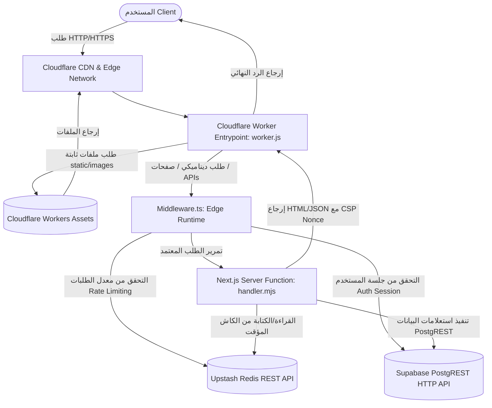

# ZAYRON-X: Deep Architecture Audit Report
## (تقرير التدقيق المعماري والهندسي الشامل لمنصة ZAYRON-X)

**التاريخ:** 4 يونيو 2026  
**الفريق الهندسي المراجع:** Principal Architecture & Security Audit Team  
**حالة التدقيق:** حرج / مراجعة هندسية للمستقبل (Architecture Assessment)

---

## 1. رسم البنية الكاملة للطلب (Full Request Flow Architecture)

ينتقل الطلب في بنية ZAYRON-X الموزعة على حافة الشبكة (Edge-Native) وفق المسار التالي:



### تفاصيل انتقال الطلب:
1. **من المستخدم إلى Cloudflare Workers:** يُوجه الطلب عبر DNS إلى حافة Cloudflare. يستقبل مكوّن `worker.js` (المدخل الرئيسي لـ OpenNext) الطلب.
2. **فرز الملفات الثابتة:** إذا كان الطلب يستهدف ملفًا ثابتًا (مثل `/_next/static/*` أو صورة)، يتم تلبيته مباشرة من ميزة Cloudflare Assets المحددة في `wrangler.toml` تحت مسار `.open-next/assets`.
3. **التشغيل في Middleware (Edge Runtime):** بالنسبة للطلبات الحيوية، يُنفذ ملف `middleware.ts`:
   - يقوم بتوليد **CSP Nonce** فريد لكل طلب لحماية الصفحات من حقن الأكواد الخبيثة.
   - يتصل بـ **Upstash Redis** عبر بروتوكول HTTP REST للتحقق من معدل الطلبات (Rate Limiting) على مسارات الدخول والتسجيل.
   - يتصل بـ **Supabase PostgREST** للتحقق من الصلاحيات وجلسة المستخدم للمسارات المحمية مثل `/api/remediate`.
4. **التمرير إلى Next.js Server:** إذا تم قبول الطلب، يُمرر إلى `handler.mjs` (الخادم الرئيسي المولد بواسطة OpenNext):
   - يتم معالجة الصفحة أو الـ API المطلوبة.
   - يتم جلب البيانات ديناميكيًا من قاعدة بيانات Supabase PostgreSQL عبر مكتبة `@supabase/supabase-js` والتي ترسل طلبات HTTP/HTTPS مباشرة إلى PostgREST.
   - يتم توجيه استعلامات الكاش الخاصة بـ CVEs إلى Upstash Redis.
5. **العودة بالرد:** يُولد الخادم الرد النهائي، ويقوم الـ Middleware بحقن الـ Nonce المولد في ترويسة الـ CSP، ثم يعود الرد عبر حافة Cloudflare إلى المستخدم مع ترويسات التحكم بالكاش (`Cache-Control` و `CDN-Cache-Control`).

---

## 2. تحليل OpenNext (OpenNext Caching & Compatibility Analysis)

تعد أداة OpenNext الجسر الرابط بين Next.js وبيئة Cloudflare Workers. كشف الفحص عن الثغرات التالية في هذا التكوين:

### أ) شطب ميزات الـ ISR والـ Tag Cache بسبب الـ Dummy Adapters
في ملف التكوين الفعلي الناتج بعد البناء (`.open-next/server-functions/default/open-next.config.mjs`)، نجد الإعدادات التالية:
```javascript
incrementalCache: "dummy",
tagCache: "dummy",
queue: "dummy"
```
* **المشكلة:** نظرًا لأن ملف `open-next.config.ts` في جذر المشروع لا يحدد صراحة استخدام محول الـ KV (`kv`) لـ `incrementalCache` و `tagCache`، يقوم OpenNext بالبناء باستخدام المحولات الوهمية (`dummy`).
* **الأثر:** ميزة التحديث المستمر للصفحات الثابتة (Incremental Static Regeneration - ISR) **معطلة تمامًا** على مستوى الحافة. الصفحات التي تم تحديد `revalidate = 60` لها (مثل الصفحة الرئيسية وصفحة الأخبار) ستعمل كصفحات ديناميكية بالكامل في كل طلب (`force-dynamic`). كذلك، فإن استدعاءات `revalidatePath` أو `revalidateTag` تفشل صامتة دون تحديث الكاش.

### ب) تجاهل خاصية `edgeExternals` في Cloudflare Adapter
يحتوي ملف `open-next.config.ts` على مصفوفة كبيرة للـ `edgeExternals` لاستبعاد مكتبات Node.js من البناء.
* **المشكلة:** محول Cloudflare الخاص بـ OpenNext (تحديدًا في مرحلة `bundle-server.js`) **يتجاهل تمامًا** مصفوفة `edgeExternals` المعرفة من قبل المستخدم ويستخدم مصفوفة مدمجة صلبة (Hardcoded) تحتوي فقط على `["./middleware/handler.mjs"]`.
* **الأثر:** أي محاولة لحل مشاكل التوافق عن طريق إضافة وحدات (modules) إلى `edgeExternals` في ملف التكوين هي محاولة عديمة الأثر (No-op)، ويجب الاعتماد فقط على سكربتات الترقيع بعد البناء (`patch-handler-fs.cjs`) أو ميزة `[build.alias]` في wrangler.

### ج) مخاطر استخدام CommonJS `require()` في حزم ESM
ينتج عن بناء Next.js خادم CommonJS، بينما يقوم OpenNext بتغليفه في ملف ES Module وهو `handler.mjs`.
* **المشكلة:** يشتمل ملف `handler.mjs` على استدعاءات `require()` لوحدات Node.js الأساسية (مثل `fs` و `os`). بيئة Cloudflare Workers عند تشغيلها كـ ESM لا تدعم الـ `require` بشكل افتراضي إلا بوجود شيم خاص أو رافعة توافق.
* **الأثر:** يعتمد المشروع حاليًا على سكربت الترقيع `patch-handler-fs.cjs` لاستبدال استدعاءات `require("node:fs")` بـ `require("./fs.cjs")`. إذا حدث خطأ في عملية البناء أو تم تخطي هذا السكربت (حيث أنه يخرج بكود 0 صامت في حال عدم العثور على الملف)، سينتج عن ذلك انهيار فوري للموقع على الحافة برمز خطأ `10021` (No such module).

### د) حجم الملف الضخم (7.6MB) وتجاوز حدود Workers
* **المشكلة:** يبلغ حجم ملف `handler.mjs` غير المضغوط **7.6 ميجابايت**.
* **الأثر:** هذا الحجم يقترب بشكل حرج من الحد الأقصى المسموح به للملفات غير المضغوطة في باقة Cloudflare Workers Paid وهو (10MB)، ويتجاوز بمراحل حد الـ (1MB) المسموح به في الحسابات المجانية. قد يؤدي إضافة أي حزمة ثقيلة في المستقبل إلى فشل النشر الفوري.

---

## 3. تحليل قاعدة البيانات (Database Layer Analysis)

تم إجراء تحول كبير في معالجة استعلامات قاعدة البيانات لحل مشكلة الانهيار الشهيرة (Worker Hung - 1101). تم رصد النقاط المعمارية التالية:

### أ) تجاوز Drizzle ORM واستخدام Supabase HTTP
* **الواقع الفعلي:** المشروع يحتوي على `drizzle-orm` و `drizzle-kit` في ملف `package.json` ويحتوي على ملفات الهجرة (Migrations) والمخططات (Schema) في مجلد `lib/db/schema.ts`. ولكن، **لا يتم استخدام Drizzle للقيام بأي عمليات استعلام في وقت التشغيل (Runtime)**.
* **آلية الاستعلام الحالية:** يتم استيراد أنواع البيانات فقط من المخطط (مثل `import type { Article }`)، بينما تتم كافة العمليات باستخدام عميل Supabase الرسمي `@supabase/supabase-js` عبر PostgREST HTTP API:
  ```typescript
  const { data, error } = await getDb().from("articles").select("*").eq("slug", slug)...
  ```
* **نوع الاتصال:** اتصالات البيانات هي بالكامل **HTTP/HTTPS (fetch-based)** ولا يتم استخدام اتصالات TCP التقليدية. تم نقل حزمة `postgres` (التي تستخدم TCP sockets وتسبب تعليق الووركر) إلى الـ `devDependencies` وتستخدم فقط في سكربتات التهيئة المحلية (Local seeding).

### ب) المخاطر الحالية والمستقبلية لبنية البيانات

#### 1. حد الاقتطاع في PostgREST (Pagination & Truncation Risk)
* **المشكلة:** تفرض واجهة PostgREST في Supabase حدًا أقصى طبيعيًا لعدد الصفوف المسترجعة في الاستعلام الواحد (عادة 1000 أو 10000 صف).
* **الخطر:** دوال مثل `getCategoriesWithCounts()` و `getAllTags()` و `getCVESeverityDistribution()` تقوم بعمل استعلام مفتوح لجلب كامل الجدول لتجميع الإحصائيات في ذاكرة الـ Javascript:
  ```typescript
  // جلب كافة المقالات لحساب التصنيفات!
  const { data } = await from().select("category").eq("is_published", true);
  ```
  عندما يتجاوز حجم البيانات في الإنتاج حد الـ PostgREST، سيقوم Supabase باقتطاع البيانات وإرجاع أول N صف فقط، مما يؤدي إلى **حسابات إحصائية خاطئة وغير دقيقة** للوسوم والتصنيفات في الموقع دون إطلاق أي خطأ.

#### 2. استهلاك ذاكرة ووقت معالجة الووركر (Isolate Memory & CPU Exhaustion)
* **المشكلة:** جلب آلاف الصفوف كـ JSON عبر شبكة الـ HTTP ومعالجتها برمجياً (In-Memory array processing) في الخادم الطرفي (Worker) يستهلك سعة معالجة عالية (CPU-bound loop).
* **الخطر:** يمتلك Cloudflare Worker حدًا أقصى لوقت المعالجة الفعلي (50ms CPU time للنسخة المجانية) وسعة ذاكرة محدودة (128MB). مع نمو البيانات، ستنهار استعلامات الصفحة الرئيسية وصفحات الوسوم مباشرة وتظهر رسائل الخطأ `1102 CPU Time Limit Exceeded`.

#### 3. تراكم زمن الاستجابة بسبب الاستدعاءات المتتالية (Sequential Awaits Latency)
* **المشكلة:** في صفحة تفاصيل الأحداث (`app/threats/[id]/page.tsx`)، يتم تنفيذ الاستعلامات بشكل متتالٍ:
  1. التحقق من المستخدم: `await supabase.auth.getUser()`
  2. جلب مستوى الأمان: `await supabase.from("profiles").select(...)`
  3. جلب تفاصيل التهديد: `await supabase.from("threat_artifacts").select(...)`
* **الخطر:** نظرًا لأن كل عملية تمثل طلب HTTP مستقل إلى خوادم Supabase، فإن زمن الاستجابة الإجمالي هو مجموع أوقات الاستجابة الثلاثة (Round-trips). إذا استغرق كل طلب 100ms، سينتظر المستخدم 300ms على الأقل قبل بدء رندرة الصفحة. يمكن تسريع هذا بتنفيذ استعلام التهديد واستعلام المستخدم بالتوازي (`Promise.all`).

#### 4. افتقار العمليات إلى الذرية (Non-Atomic Updates / Race Conditions)
* **المشكلة:** دالة زيادة عدد المشاهدات للمقالات `incrementArticleViews(id)` تعمل كالتالي:
  ```typescript
  const { data: current } = await from().select("views").eq("id", id).single();
  const currentViews = current?.views ?? 0;
  return from().update({ views: currentViews + 1 }).eq("id", id);
  ```
* **الخطر:** هذا النمط (Read-Modify-Write) ليس ذريًا (Not Atomic). عند وجود زيارات متزامنة لنفس المقال في نفس اللحظة، سيقرأ المستخدِمون نفس العدد القديم ويكتبون نفس العدد الجديد + 1، مما يتسبب في ضياع إحصائيات القراءة الحقيقية. يجب استخدام استدعاء إجراء مخزن (Supabase RPC) لتنفيذ `views = views + 1` على مستوى قاعدة البيانات مباشرة.

#### 5. انهيار الصفحة بسبب محاولة تعديل الكوكيز في الـ Server Components
* **المشكلة:** في ملف `lib/supabase/server.ts` داخل الدالة `createClient` و `createAdminClient`:
  ```typescript
  setAll(cookiesToSet) {
    for (const { name, value, options } of cookiesToSet) {
      cookieStore.set(name, value, options);
    }
  }
  ```
* **الخطر:** تمنع Next.js بشكل صارم تعديل الكوكيز (Writing/Setting cookies) أثناء عملية رندرة المكونات البرمجية للخادم (Server Components). إذا انتهت صلاحية رمز الجلسة (Session Token) للمستخدم وحاول العميل تلقائيًا تحديث الجلسة واستدعاء `setAll` داخل صفحة خادم (مثل `app/threats/[id]/page.tsx`)، ستنهار الصفحة فورًا وتُرجع خطأ خادم داخلي (500). يجب حماية عملية تعديل الكوكيز أو تفويضها بالكامل للـ Middleware.

---

## 4. تحليل Cloudflare Workers (Edge Compatibility Analysis)

تمنع طبيعة بيئة عمل Cloudflare Workers (V8 Isolates) تشغيل المكتبات البرمجية التي تعتمد على واجهات نظام التشغيل الخاصة بـ Node.js.

### أ) الوحدات غير المدعومة وكيف تم عزلها:
* **الوحدات المحظورة:** `node:fs`, `node:path`, `node:os`, `node:net`, `node:tls`, `child_process`, `worker_threads`.
* **الاستيراد المباشر:** لا توجد ملفات في بيئة التشغيل (`app` و `lib`) تقوم باستيراد هذه المكتبات مباشرة. الملفات الوحيدة التي تستوردها هي ملفات التكوين والتهيئة التي تعمل محليًا أثناء البناء فقط (`scripts/deploy-vercel.ts` و `scripts/run-migration.ts` و `vitest.config.ts`).
* **الاستيراد غير المباشر (Next.js Internals & Sentry):** تقوم الأكواد المدمجة في خادم Next.js وبعض أجزاء مكتبة Sentry باستدعاء هذه الوحدات داخليًا.
* **الحل الفعلي المطبق:** 
  1. يقوم سكربت `scripts/patch-handler-fs.cjs` بمسح حزمة `handler.mjs` بحثًا عن استدعاءات `require("node:fs")` وغيرها ويستبدلها بإشارات إلى ترقيعات محلية CommonJS وهي:
     - `lib/polyfills/fs.cjs` (ترقيع واجهة نظام الملفات بإرجاع قيم افتراضية آمنة أو رمي خطأ `ENOSYS` للعمليات التعديلية).
     - `lib/polyfills/os.cjs` (ترقيع واجهة معلومات نظام التشغيل).
     - `lib/polyfills/noop.cjs` (ترقيع عام فارغ لجميع الوحدات الأخرى مثل `net` و `tls` و `child_process`).

---

## 5. تحليل الأداء (Performance & Caching Analysis)

كشف الفحص عن ثغرات أداء قد تؤدي إلى تدهور سرعة الموقع عند زيادة التحميل:

### أ) استعلامات التجميع البطيئة (Slow Aggregate Queries)
الاستعلامات التالية تمثل عنق زجاجة حقيقي لقاعدة البيانات والشبكة:
1. **حساب عدد مشاهدات المقالات:** يقوم `getTotalViews` بجلب عمود `views` لجميع المقالات ثم استخدام `reduce` في خادم الـ Node/Worker لجمع المشاهدات.
2. **توزيع تصنيفات CVEs:** تقوم `getCVESeverityDistribution` بجلب عمود `severity` لجميع سجلات جدول الـ CVEs لحساب التوزيع في الذاكرة.
3. **تجميع الوسوم:** تقوم `getAllTags()` بجلب مصفوفة الوسوم لكافة المقالات للفرز والعد برمجياً.
* **البديل الصحيح:** يجب استبدالها باستعلامات تجميعية حقيقية في قاعدة البيانات (مثل `select category, count(*) group by category`) أو تفعيل استخدام الآراء المادية (Materialized Views) مثل `mat_tags` المنشأة بالفعل في الهجرة `0001_performance_indexes.sql` ولكن **لم يتم تفعيل الاستعلام منها في الكود البرمجي المكتوب حتى الآن!**

### ب) خطأ الازدواج البرمجي في كاش Redis (Double JSON Serialization Bug)
* **المشكلة:** في ملف `lib/cache/redis.ts` ضمن الدالة `getCachedOrFetch`:
  ```typescript
  // كتابة البيانات إلى Redis
  await redis.set(key, JSON.stringify(freshData), { ex: ttlSeconds });
  ```
  وتقوم الدالة بجلب البيانات عبر:
  ```typescript
  const cachedData = await redis.get<T>(key);
  ```
* **الخطر:** عميل `@upstash/redis` يقوم تلقائيًا بتحويل الكائنات (Objects) إلى سلسلة نصية JSON عند الكتابة، ويقوم بفكها تلقائيًا عند القراءة. بتمرير `JSON.stringify(freshData)` يدويًا، يتم تخزين البيانات كـ **Double-Serialized JSON String**.
  عند القراءة، سيعيد عميل Redis قيمة نصية (String) تحتوي على كود الـ JSON بدلاً من كائن (Object) مفكك. هذا يتسبب في فشل فوري في السكربتات التي تتوقع مصفوفة أو كائن (مثل `result.cves` التي ستصبح `undefined` وتؤدي لانهيار الـ API في حال حدوث Cache Hit).

### ج) الكاش الوهمي (Dummy Cache)
نظرًا لتعطيل الـ Cache الفعلي في إعدادات OpenNext كما هو موضح في الباب الثاني، فإن الموقع بالكامل يخضع لمعالجة ديناميكية متكررة لكل طلب، مما يزيد العبء المالي لمعالجات Supabase و Upstash بشكل كبير.

---

## 6. تحليل Next.js (Next.js Routing & Static Rendering Audit)

### أ) وهم الـ `generateStaticParams`
* **المشكلة:** تذكر بعض وثائق المشروع والتقارير المعمارية السابقة استخدام ميزة البناء الاستاتيكي للمقالات عبر `generateStaticParams`.
* **الواقع الفعلي:** عند مراجعة الكود، **لا توجد أي صفحة تستخدم دالة `generateStaticParams`**. كافة الصفحات في مسار `intelligence/[category]` و `intelligence/[category]/[slug]` تستخدم صراحة الإعدادات التالية:
  ```typescript
  export const dynamic = "force-dynamic";
  export const revalidate = 0;
  ```
  هذا يعني أن الموقع يعمل بالكامل بنظام رندرة خادم ديناميكية (SSR) معطلة الكاش، ولا يوجد أي إنشاء لصفحات استاتيكية أثناء البناء.

### ب) ثغرة تسميم الكاش (404 Cache Poisoning)
* **المشكلة:** في صفحة تصنيفات المقالات `app/intelligence/[category]/page.tsx` عند طلب تصنيف غير موجود في قاعدة البيانات (مثل `/intelligence/fake-category`):
  ```typescript
  if (!articles.length) {
    return <ZeroIntelReport categoryName={displayCategory} />;
  }
  ```
  يعود هذا المكون بصفحة طبيعية تحتوي على رسالة تفيد بعدم وجود مقالات، ولكن الطلب ينتهي بـ **حالة نجاح 200 OK** بدلاً من رمي خطأ `404` أو استدعاء `notFound()`.
* **الخطر:** يمكن للمخترقين أو برمجيات الزحف توليد ملايين الروابط العشوائية للموقع وسيقوم خادم الحافة (أو كاش المتصفحات) بتخزين هذه الصفحات الفارغة كصفحات ناجحة (200)، مما يستهلك موارد الأداء ويسمم أرشفة محركات البحث (SEO).

---

## 7. تحليل GitHub Actions (CI/CD Pipeline Audit)

ملف التحكم بالنشر التلقائي هو `.github/workflows/zayron-deploy.yml`. تم العثور على الأخطاء التالية:

### أ) خطأ البيئة الحرج (Hardcoded Preview Deployment Bug)
* **المشكلة:** يطلق ملف العمل الأحداث عند عمل push على فرع الإنتاج `production`:
  ```yaml
  on:
    push:
      branches:
        - production
  ```
  ولكن في خطوات النشر، تم تحديد بيئة العمل صراحة كـ `preview`:
  ```yaml
  env:
    WORKER_ENV: "preview"
  ```
  ويتم تمريرها لأداة wrangler:
  ```yaml
  command: deploy --env ${{ env.WORKER_ENV }}
  ```
* **الأثر:** أي تحديث على الكود المصدري في فرع الإنتاج الرئيسي سيتم نشره تلقائيًا في بيئة المعاينة (Preview Worker) ولن يتم تحديث موقع الإنتاج الفعلي (`zayron-x.com`) نهائيًا عبر الـ CI/CD. يجب معالجة هذا الخطأ فورًا ليفصل بين الفرعين والبيئتين.

---

## 8. تحليل الأمان (Security & Credentials Audit)

### أ) تسرب واعتماد كود السريات بشكل صلب (Hardcoded Public Credentials)
* **المشكلة:** يحتوي ملف التكوين `next.config.ts` في الأسطر 28-31 على قيم صلبة وحقيقية للمتغيرات التالية:
  ```typescript
  NEXT_PUBLIC_SUPABASE_URL: "https://xdfndojvqazffcjngglr.supabase.co"
  NEXT_PUBLIC_SUPABASE_ANON_KEY: "eyJhbGciOiJIUzI1NiIsInR5..."
  ```
  وكذلك يحتوي ملف `instrumentation-client.ts` في الجذر على رابط DSN حقيقي لـ Sentry:
  ```typescript
  dsn: "https://d1afe5ace232bbe49305275b8a283471@o4511497263316993.ingest.us.sentry.io/4511497286254592"
  ```
* **الأثر:** على الرغم من أن هذه المفاتيح عامة (Public Anon) ومصممة لتوضع في المتصفح، إلا أن الالتزام ببيئة عمل نظيفة يقتضي عدم تضمينها صلبة في الكود لتسهيل عملية التبديل بين بيئات التطوير والإنتاج دون الحاجة لإعادة بناء الحزم.

### ب) خلل في تفعيل Sentry على جانب العميل (Client-Side Sentry Fail)
* **المشكلة:** تعتمد إعدادات Sentry في العميل `sentry.client.config.ts` على المتغير العام المعرف في الحافة `NEXT_PUBLIC_SENTRY_DSN`.
* **الخطر:** في تطبيق Next.js، تُحقن متغيرات `NEXT_PUBLIC_` في حزمة المتصفح (Client bundle) **أثناء وقت البناء فقط (Build Time)**. نظرًا لأن المتغير معرف كسرّ في بيئة عمل الووركر (Runtime wrangler secret)، فلن تتم قراءته أثناء البناء البرمجي في الـ GitHub Runner. وبالتالي، ستبنى الحزمة بدون عنوان Sentry، مما يؤدي إلى **تعطل ميزة تتبع أخطاء المتصفح تمامًا في الإنتاج**.

### ج) ازدواجية التحقق في بوابة الإدارة (Middleware Double-Gating Conflict)
* **المشكلة:** يفرض ملف `middleware.ts` حماية Basic Auth على مسار `/admin`:
  ```typescript
  if (pathname.startsWith("/admin")) {
    if (!isAdminAuthenticated(request)) { ... return 401 ... }
  }
  ```
  وإذا نجح التحقق، لا يخرج الكود بل يكمل استدعاء `updateSession` والذي يقوم بـ:
  ```typescript
  if (pathname.startsWith("/admin")) {
    if (!user) { ... redirect to /login ... }
  }
  ```
* **الأثر:** يتطلب الدخول للوحة الإدارة تجاوز تحققيْن اثنيْن في نفس الوقت: إدخال بيانات الـ Basic Auth وحصول المستخدم على جلسة Supabase نشطة. هذا يسبب ارتباكًا في مسار تجربة المستخدم وأعطال تسجيل الدخول في حال لم يُرسل المتصفح ترويسات المصادقة الأساسية.

---

## 9. قائمة الأخطاء وتصنيفها (Detailed Issue Register)

| الخطأ | الخطورة | السبب | الحل | الأولوية |
| :--- | :--- | :--- | :--- | :---: |
| **تعطل ISR والـ Cache بالكامل** | **حرجة جداً** | إعداد `incrementalCache: "dummy"` في OpenNext. | إضافة الإعدادات `"kv"` لـ `incrementalCache` و `tagCache` في ملف `open-next.config.ts`. | **عالية جداً** |
| **خطأ بيئة النشر في CI/CD** | **حرجة** | المتغير `WORKER_ENV` مضبوط بشكل صلب على `"preview"` في الجوب. | تعديل السكربت ليقرأ البيئة بناءً على اسم الفرع (production -> production). | **عالية جداً** |
| **انهيار الصفحة عند تحديث الجلسة** | **حرجة** | استدعاء `cookieStore.set` داخل Server Components. | تعديل `setAll` في `server.ts` ليتجاهل الكتابة صامتًا أو التقاط الاستثناء مع تفويضها لـ Middleware. | **عالية** |
| **خلل كاش Redis (Double JSON)** | **عالية** | كتابة بيانات مُحولة يدويًا بـ `JSON.stringify` لـ Redis. | تخزين الكائن مباشرة في `redis.set` دون تحويل نصي يدوي. | **عالية** |
| **تسميم الكاش (404 Cache Poisoning)** | **متوسطة** | إرجاع حالة 200 OK للمقالات أو الأقسام غير الموجودة. | استدعاء `notFound()` لإرجاع حالة 404 حقيقية بدلاً من عرض صفحة نجاح فارغة. | **متوسطة** |
| **استعلامات التجميع المنهكة** | **عالية** | جلب كامل الجدول لحساب الأعداد والوسوم والمشاهدات برمجياً. | التعديل لاستدعاء الآراء المادية `mat_tags` أو عمل استعلامات SQL تجميعية (`group by`). | **عالية** |
| **ازدواجية مصادقة لوحة الإدارة** | **متوسطة** | تداخل حماية Basic Auth مع حماية Supabase Session. | تبسيط نموذج التحقق ليعتمد على أحدهما أو فصل مسارات لوحة التحكم الإدارية. | **متوسطة** |
| **تعطل Sentry في المتصفح** | **متوسطة** | غياب قيمة `NEXT_PUBLIC_Sentry_DSN` أثناء وقت البناء. | توفير الـ DSN كـ Environment Variable أثناء البناء في خادم الـ CI. | **متوسطة** |
| **سباق البيانات في عداد المشاهدات** | **متوسطة** | التحديث بنمط Read-Modify-Write غير الذري. | استخدام إجراء مخزن RPC لتحديث القيمة مباشرة في قاعدة البيانات. | **متوسطة** |

---

## 10. قائمة الأخطاء المستقبلية (Future Failure Scenarios)

### أ) خلال شهر (مع بلوغ 1,000 مستخدم نشط)
* **المشكلة:** **انهيارات متفرقة في صفحات تفاصيل التهديدات.**
* **السيناريو:** مع زيادة الجلسات النشطة، سيبدأ منتهي الصلاحية لبعض المستخدمين بالدخول لصفحة التهديد `/threats/[id]`. سيقوم عميل Supabase بمحاولة تحديث الجلسة، مما يؤدي لاستدعاء `cookieStore.set` وانهيار الصفحة برمز 500 للمستخدمين بشكل عشوائي ومحبط.

### ب) خلال 6 أشهر (مع بلوغ 10,000 مستخدم نشط)
* **المشكلة:** **بطء شديد وتأخر تحميل الصفحة الرئيسية وصفحة التهديدات.**
* **السيناريو:** مع زيادة حجم المقالات لـ 2,000 مقال وتعدي الـ CVEs لـ 5,000 سجل:
  1. ستقوم دالة `getCategoriesWithCounts` وجلب المشاهدات بسحب كامل محتوى الجدول عبر HTTP في كل عملية بناء كاش (أو في كل طلب نظرًا لتعطل ISR). سينتج عن ذلك أزمنة استجابة تتجاوز ثانية كاملة لـ PostgREST.
  2. ستبدأ عمليات الاقتطاع التلقائية في Supabase PostgREST، لتظهر الوسوم والإحصائيات بأرقام مجزوءة وخاطئة للزوار.

### ج) خلال سنة (مع بلوغ 100,000 مستخدم نشط)
* **المشكلة:** **انهيار شامل للموقع الطرفي (1102 - Worker Hung / CPU Limit Exceeded).**
* **السيناريو:** مع امتداد قاعدة البيانات لـ 50,000 مقال و 100,000 CVE:
  1. سيتجاوز حجم مصفوفة المقالات المسترجعة لحساب الوسوم والتصنيفات سعة الذاكرة المخصصة لـ V8 Isolate (128MB) مما يؤدي لانهيار خادم الحافة بالكامل (Out of Memory).
  2. حلقات التكرار البرمجية (`for` loops) لمعالجة الوسوم وتصفيتها ستحتاج لوقت معالجة CPU يتعدى الـ 50ms بكثير. ستغلق Cloudflare الطلبات فورًا وتعرض صفحة خطأ للزوار.
  3. استهلاك خطة طلبات Upstash Redis المجانية أو المنخفضة سريعا نتيجة لعدم فك الكاش بشكل سليم (Double-Serialization) وتحول كافة الطلبات لاستعلامات مباشرة لقاعدة البيانات.
