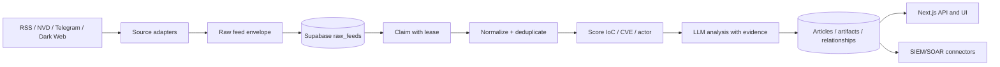

# ZAYRON-X Core Architecture and Strategic Feasibility 2026

> Status: repository-derived source of truth, 2026-08-18. Verified facts are marked **Observed**; target-state items are marked **Directive**. This document supersedes narrative inventory reports for architectural decisions, but does not erase migration history or audit evidence.

## 1. Executive Technical Summary

ZAYRON-X is a hybrid cyber-threat-intelligence platform composed of a Next.js 16 / React 19 web application, Cloudflare Workers delivery, Supabase/PostgreSQL persistence, and Python ingestion/orchestration workers. Its product wedge is the conversion of heterogeneous public, vulnerability, Telegram, and dark-web signals into scored, analyst-oriented intelligence with operational integrations.

**Observed feasibility:** the repository contains the core building blocks for a production CTI MVP: App Router pages and API routes, Supabase SSR clients and query modules, Python RSS/CVE/Telegram/dark-web ingestors, Pydantic models, worker persistence, Docker Compose, tests, and Cloudflare OpenNext configuration.

**Primary architectural risk:** the repository is not yet a single deployable graph. It contains a large document/evidence estate, two dependency roots, several historical SQL files, an inactive TypeScript ingestion path, and deployment metadata that currently points at Worker `zayron-x` while the inspected Cloudflare account did not expose that Worker or a Pages project. Deployment identity must be reconciled before production claims are made.

**Positioning:** ZAYRON-X should compete as an explainable, source-grounded CTI operations layer for lean SOC teams, not as a generic feed reader. Differentiators should be evidence lineage, tenant-isolated scoring, analyst workflow, and controlled response integrations. Do not market automated remediation until policy gates, approvals, audit trails, and connector contracts are enforced.

## 2. Repository Baseline

### 2.1 Observed runtime map

| Plane | Current implementation | Boundary | Main risk |
|---|---|---|---|
| Web UI | `zayron-x/app`, `components`, `lib` | Cloudflare OpenNext Worker | Node compatibility and route/runtime drift |
| Edge API | Next.js route handlers under `zayron-x/app/api` | Supabase HTTP, Stripe, Resend, Redis | Secret exposure, inconsistent auth/rate limits |
| Ingestion | `workers/ingestors/*.py` | External feeds, Tor/SOCKS5, NVD | Backpressure, source failure, legal/operational controls |
| Analysis | `workers/omni_crew.py`, `workers/agents` | LLM and database | Non-determinism, prompt/data poisoning |
| Persistence | `workers/persistence.py`, Supabase SQL | PostgreSQL | Service-role blast radius and RLS drift |
| Delivery | `zayron-x/wrangler.toml`, OpenNext | Cloudflare account | Account/project identity mismatch |
| Evidence | `evidence`, `graphs`, `metrics`, reports | Local/Git artifacts | Conflicting source-of-truth documents |

### 2.2 Absolute target directory tree

```text
zayron-app/
├── apps/
│   └── web/                         # canonical Next.js application
│       ├── app/                     # UI and route handlers
│       ├── components/
│       ├── lib/
│       ├── public/
│       ├── tests/
│       ├── package.json
│       └── wrangler.toml
├── services/
│   ├── ingestion/                   # Python feed collectors
│   │   ├── sources/
│   │   ├── contracts/
│   │   └── tests/
│   └── analysis/                    # scoring, enrichment, agent orchestration
├── packages/
│   └── contracts/                   # versioned JSON/Pydantic/TypeScript schemas
├── supabase/
│   ├── migrations/                  # immutable, ordered migrations only
│   ├── seed/
│   └── tests/
├── ops/
│   ├── docker/
│   ├── cloudflare/
│   └── runbooks/
├── scripts/
│   ├── prune-zayron-x.ps1
│   └── verify/
├── docs/
│   └── ZAYRON-X_Core_Architecture_and_Strategic_Feasibility_2026.md
└── .github/workflows/
```

Migration to this tree is a staged refactor. Do not move directories until imports, Docker contexts, CI paths, and deployment manifests are updated together.

## 3. Dependency and Component Matrix

| Component | Evidence in repository | Responsibility | Required contract |
|---|---|---|---|
| Homepage and site shell | `zayron-x/app/(site)`, `components/layout` | Public discovery and navigation | Server-rendered, locale-aware, cache-safe |
| Intelligence views | `app/intelligence`, `app/news`, `app/(site)/article` | Browse and inspect intel | Source lineage, freshness, authorization |
| CVE surface | `app/(site)/cve`, `components/cve`, `app/api/cves` | Vulnerability discovery | NVD ID uniqueness, severity normalization |
| Admin surface | `app/admin` | Editorial and operational controls | MFA, RBAC, audit logging |
| Threat APIs | `app/api/articles`, `api/search`, `api/remediate`, `api/status` | Data access and actions | Zod validation, authn/authz, rate limits |
| Supabase clients | `lib/supabase/client.ts`, `server.ts`, `middleware.ts` | Session and data access | Browser anon key only; service role server-only |
| Python ingestors | `workers/ingestors` | Source collection | Idempotent envelope and retry policy |
| Crew analysis | `workers/omni_crew.py` | Enrichment and report generation | Prompt version, model version, evidence refs |
| Shared models | `shared/models` | Cross-service data shape | Versioned schema compatibility |
| Cloudflare Worker | `worker-wrapper.js`, `wrangler.toml` | Edge delivery | Worker name/account/domain consistency |

## 4. Ingestion and CTI Data Flow



**Directive:** every event must carry `event_id`, `source`, `observed_at`, `ingested_at`, `content_hash`, `schema_version`, `confidence`, and `evidence_refs`. Deduplicate on `(source, content_hash)` and make writes idempotent.

**Concurrency model:** use bounded async I/O per source, a queue-backed claim/lease table, exponential backoff with jitter, circuit breakers per provider, and dead-letter records. Python is acceptable for source integrations; Bun/TypeScript should be used only where it reduces operational complexity, not as a second ungoverned ingestion plane.

**IoC scoring baseline:** combine source reliability, recency decay, corroboration count, entity confidence, exploitability, and tenant relevance. Store component scores and model/version metadata; never persist only a final opaque score.

## 5. Supabase/PostgreSQL and Zero Trust

### 5.1 Required schema domains

| Domain | Canonical tables to enforce | Controls |
|---|---|---|
| Tenancy | `organizations`, `memberships`, `roles` | Tenant key on every customer row |
| Collection | `sources`, `raw_feeds`, `ingestion_runs` | Idempotency and lease fields |
| Intelligence | `articles`, `cves`, `iocs`, `relationships` | Provenance and confidence |
| Workflow | `cases`, `tasks`, `approvals`, `actions` | Separation of duties |
| Audit | `audit_events`, `model_runs`, `connector_events` | Append-only, actor/request IDs |

### 5.2 RLS directives

1. Enable RLS on every tenant-owned table and add a deny-by-default policy posture.
2. Resolve tenant membership from a server-validated JWT claim or membership lookup; never trust a client-supplied organization ID.
3. Keep `service_role` in worker secrets only. Workers must use narrowly scoped RPCs where possible.
4. Add negative RLS tests: cross-tenant select, insert, update, delete, and RPC invocation.
5. Treat SQL files outside an ordered migration directory as proposals or evidence, not deployable state.
6. Use PostgreSQL audit triggers for privileged mutations and retain immutable action receipts.

“LUKS-level encryption” is an infrastructure-at-rest concern, not an application substitute. Application controls still require TLS, encrypted provider storage, secret rotation, field minimization, redaction, and key separation for tenant-sensitive content.

## 6. Edge-Native Performance

The current Cloudflare config uses OpenNext, `nodejs_compat`, Workers Assets, and KV bindings. This is viable, but the observed production environment has `workers_dev = true` and commented custom routes. Treat the deployment as preview until domain routing and account ownership are verified.

Performance directives:

- Keep public pages server-rendered and cacheable; isolate personalized/authenticated routes.
- Use `Cache-Control`/stale-while-revalidate for public intelligence summaries and KV only for bounded cache objects.
- Avoid importing Python, filesystem, or large Node-only packages into edge route modules.
- Stream large reports and use cursor pagination for feeds, CVEs, and search.
- Co-locate Supabase region, Cloudflare service geography, and worker workloads after measuring p50/p95 rather than assuming sub-10ms end-to-end database latency.
- Define budgets: edge CPU, response bytes, cold-start rate, cache hit ratio, p95 TTFB, and origin error rate.
- “Sub-10ms” is realistic for cache hits near the user, not for uncached Supabase/LLM workflows; publish separate edge-hit and origin-backed SLOs.

## 7. SOC Ecosystem Integration Blueprint

| System | Direction | Integration shape | Safety gate |
|---|---|---|---|
| Wazuh | ZAYRON-X -> Wazuh | Signed alert/event webhook or API adapter | Tenant-scoped token, schema validation |
| Velociraptor | Bidirectional | Approved hunt request and result ingestion | Human approval, artifact allow-list |
| Numbat | ZAYRON-X -> Numbat | Normalize IoCs to connector schema | Confidence threshold and expiration |
| Mythic C2 | Read-only initially | Detection/context enrichment | Never issue tasking by default; explicit break-glass approval |

All connectors require an outbox, retry state, idempotency key, delivery receipt, secret rotation, and audit event. Remediation must be a state machine: proposed -> approved -> dispatched -> acknowledged -> verified -> closed/rolled-back.

## 8. Security and Threat Model Priorities

1. Protect admin and remediation routes with MFA, role checks, CSRF protections where cookie-authenticated, and explicit origin checks.
2. Treat RSS, Telegram, dark-web text, and LLM outputs as hostile input. Sanitize HTML, constrain prompts, and prevent instruction/data confusion.
3. Add SSRF controls to all URL fetchers: scheme allow-list, DNS/IP validation, redirect limits, private-range blocking, and egress policy.
4. Do not expose raw dark-web content or secrets in logs, traces, generated reports, or Sentry payloads.
5. Sign high-impact connector requests and bind them to an approval and expiry window.
6. Add dependency, secret, container, IaC, and SBOM scanning to CI; pin base images by digest.

## 9. Pruning Decision Register

### Safe generated artifacts

The accompanying `scripts/prune-zayron-x.ps1` removes only build/runtime artifacts such as `.next`, `.open-next`, `.wrangler`, `.vercel`, Python caches, and `.pytest_cache`. It runs in dry-run mode unless `-Apply` is supplied.

### Review-only candidates

| Candidate | Current evidence | Decision |
|---|---|---|
| `zayron-x/lib/ingestion/orchestrator.ts` | Report says no active imports | Delete only after import graph and historical release check |
| `zayron-x/scripts/telegram-ingestion.ts` | Described as mock | Archive or test explicitly before removal |
| `zayron-x/pages/dummy.tsx` | Legacy Pages Router artifact | Remove after build and route smoke tests |
| `docs/audits/wip-homepage-redesign-backup` | Untracked audit backup | Preserve until owner confirms disposal |
| Duplicate SQL files | Multiple policy/migration variants exist | Consolidate into ordered migrations, never blind-delete |

The repository currently contains an untracked `docs/audits` tree. It is preserved because it may be user work and must not be treated as dead code automatically.

## 10. CI/CD and 24-Month Roadmap

### 0-3 months: establish truth

- Reconcile Cloudflare account ID, Worker name, custom domain, KV IDs, and Git deployment environment.
- Choose one package root and one canonical migration directory.
- Add type-check, lint, unit, integration, e2e, Python tests, secret scan, and SBOM gates.
- Add schema registry and event envelope versioning.
- Add RLS negative tests and route authorization matrix.

### 4-6 months: harden ingestion

- Introduce queue/lease semantics and dead-letter handling.
- Add source health dashboards, freshness SLOs, and per-source circuit breakers.
- Separate raw immutable evidence from normalized intelligence.
- Add deterministic scoring fixtures and prompt/model regression tests.

### 7-12 months: operationalize SOC connectors

- Ship Wazuh and Numbat read/export adapters first.
- Add Velociraptor approved-hunt workflow with result verification.
- Keep Mythic read-only until governance, approvals, and rollback are proven.
- Introduce outbox delivery, signing, replay protection, and connector canaries.

### 13-18 months: scale and isolate

- Split ingestion and analysis deployment units; autoscale by queue depth and provider rate limits.
- Partition high-volume event tables by time/tenant where measured workload justifies it.
- Add read replicas or analytical export only after query and index evidence.
- Move secrets to managed rotation and enforce short-lived credentials.

### 19-24 months: enterprise readiness

- Define regional data residency and retention policies.
- Complete external penetration testing, tabletop exercises, and disaster recovery drills.
- Publish tenant isolation evidence, connector certifications, and SLO history.
- Add policy-as-code for remediation and change management.

## 11. Acceptance Gates

The architecture is production-ready only when all are true:

- Cloudflare deployment identity is verified by a successful read/deploy in the intended account.
- One canonical web package and one canonical migration history are documented.
- RLS cross-tenant tests pass.
- Every ingestion path is idempotent, observable, and bounded.
- LLM outputs are evidence-linked and versioned.
- Remediation connectors require approval and generate immutable audit records.
- CI blocks secrets, vulnerable dependencies, failed tests, schema drift, and unreviewed destructive migrations.

## 12. Current Cloudflare Verification Record

The connected Cloudflare account was readable, but API checks found no Pages project and no Worker named `zayron-x` in that account. The repository configuration references account ID `56534d53775d8280011a325dcf36ed09`, while the connected account identity differed. This is a deployment ownership/configuration mismatch, not proof that the site code is absent. Resolve it before any production cutover.
