# ZAYRON-X: Database Dependency Graph
**Target System:** ZAYRON-X Autonomous CTI Platform  
**Scope:** Table Mappings, Triggers, RLS Rules, and Functional Data Relationships  
**Timestamp:** 2026-06-11T03:49:00Z  

---

## 1. Relational Map (Foreign Keys & References)

The schema utilizes a clean set of relational associations. The core references are mapped as follows:

```
[auth.users] (Supabase Auth Core)
      │
      └── (id) Auto-Sync Trigger
            │
            ▼
[public.profiles] (Security Level)
      │
      └── (id) clearance_level checked by check_is_subscriber()
            │
            ▼
[public.threat_artifacts] (Gated SQL View)
            ▲
            │ (Union Query Masking)
            │
[public.threat_artifacts_secure] (Raw Storage)

[public.articles] (Published Briefs)
      ▲
      │ (id) Foreign Key REFERENCE (ON DELETE SET NULL)
      │
[public.trending] (Engagement Metrics)
```

- **Profile Gating**: The view `public.threat_artifacts` acts as a security filter layer sitting on top of `public.threat_artifacts_secure`. It queries `public.check_is_subscriber()` dynamically on execution, creating a run-time dependency on `public.profiles`.
- **Engagement Relationship**: The table `public.trending` contains the field `article_id` which acts as a foreign key pointing to `articles(id)` with `ON DELETE SET NULL` cascade behavior.

---

## 2. Trigger Dependency Flows

```mermaid
graph TD
    subgraph Trigger 1: Auth Synchronizer
        A[Insert into auth.users] -->|fires after insert| B(on_auth_user_created trigger)
        B -->|executes| C[public.handle_new_user function]
        C -->|inserts default FREE record| D[(public.profiles)]
    end

    subgraph Trigger 2: Column Updater
        E[Update on public.articles] -->|fires before update| F(articles_updated_at trigger)
        F -->|executes| G[public.update_updated_at_column function]
        G -->|sets updated_at = NOW| H[(public.articles)]
    end
```



---

## 3. RLS Dependency Matrix

Row Level Security (RLS) policies reference other tables to make access decisions. This creates secondary database dependencies:

```
[Client Select on threat_artifacts]
              │
              ▼
  Fires check_is_subscriber()
              │
              ▼
  Selects clearance_level from profiles where id = auth.uid()
              │
              ▼
  If profile clearance == 'SUBSCRIBER', returns columns unmasked.
  Otherwise, returns '[ RESTRICTED_INTEL ]'.
```

- **Decoupled Verification**: By setting the helper function `check_is_subscriber()` as a `SECURITY DEFINER`, it runs with the permissions of the database owner rather than the client session. This allows it to bypass standard RLS restrictions on the `profiles` table to read user status, avoiding circular policy lookup locks.
