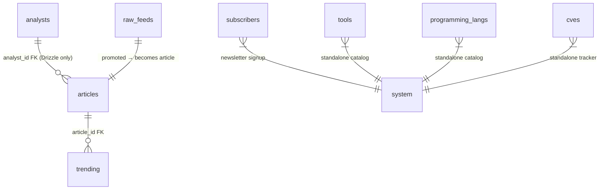

# ZAYRON-X — Technical & Conceptual Master Dossier

> **Classification:** INTERNAL — ARCHITECTURE AUDIT  
> **Date:** 2026-05-15  
> **Auditor:** Principal Enterprise Architect / Lead Data Scientist / CISO  
> **Scope:** Full-stack bit-by-bit codebase scan — schema, routing, pipeline, UI, security

---

## 1. THE CORE CONCEPT & PHILOSOPHY

### What Is ZAYRON-X?

**ZAYRON-X is NOT a blog.** It is an **AI-Augmented Cyber Threat Intelligence Fusion Center** disguised as a high-end digital newspaper. The codebase reveals a three-tier architecture:

| Layer | Purpose | Evidence |
|-------|---------|----------|
| **Ingestion** | Automated OSINT collection from 30 Telegram channels + 3 RSS feeds | `channels.ts` (30 channels), `cti_ingestion_engine.py`, `telegram-ingestion.ts` |
| **Analysis** | AI-powered translation, enrichment, MITRE/ISO/NIST mapping, analyst persona assignment | `orchestrator.ts` (21 analysts), `telegram-prompt.ts` (DeepSeek doctrine), `cti_ingestion_engine.py` (GPT-4o SITREP) |
| **Presentation** | Newspaper-style editorial frontend rendering classified intelligence as publishable articles | `page.tsx` (homepage), `globals.css` (editorial design system), `silos.ts` (tri-sector routing) |

### The Overarching Mission

Based on schema names (`raw_feeds`, `cves`, `analysts`, `articles`, `trending`), channel definitions (Russian OSINT, APT Notes, CVE Notify), and the 21-persona analyst core spanning 17 nationalities — this platform's mission is:

> **To ingest raw multilingual cyber threat intelligence from global OSINT channels, enrich it through AI analysis with ISO 27001 / NIST CSF / MITRE ATT&CK compliance mapping, assign domain-expert analyst personas for credibility, and publish it as premium editorial-grade intelligence reports.**

The system operates across a **Tri-Sector Silo Doctrine**:
- **SILO A — Cybersecurity:** Malware, APT, Data Breach, CVEs, Ransomware
- **SILO B — Programming:** Secure Coding, Rust, Python Security, Go Automation  
- **SILO C — Networking:** Protocol Deep Dives, Network Hardening, Packet Analysis

---

## 2. INFRASTRUCTURE & BACKEND MATRIX

### 2.1 Technology Stack

| Component | Technology | Version |
|-----------|-----------|---------|
| **Runtime** | Bun | Latest (via `bun --bun`) |
| **Framework** | Next.js (App Router) | 16.2.6 |
| **Language** | TypeScript | 5.8.3 |
| **ORM** | Drizzle ORM | 0.42.0 |
| **Database** | Supabase PostgreSQL | Project `xdfndojvqazffcjngglr` |
| **Auth** | Supabase Auth (@supabase/ssr) | 0.10.3 |
| **Cache** | Upstash Redis | @upstash/redis 1.34.6 |
| **Rate Limiting** | Upstash Ratelimit | 2.0.5 |
| **CSS** | Tailwind CSS v4 | 4.1.4 |
| **Animation** | Framer Motion | 11.18.2 |
| **Search** | Fuse.js (client) + PostgreSQL FTS (server) | 7.1.0 |
| **Markdown** | react-markdown + rehype/remark | 10.1.0 |
| **Email** | Resend | 4.2.0 |
| **Images** | Sharp + Next.js Image Optimization | 0.34.1 |
| **Icons** | Lucide React (direct imports) | 0.487.0 |
| **AI (Python)** | OpenAI SDK (GPT-4o / DALL-E 3) | AsyncOpenAI |
| **Ingestion (Python)** | aiohttp + feedparser | async |

### 2.2 Database Connection Strategy

```typescript
// lib/db/index.ts — DIRECT CONNECTION (not pooled)
const client = postgres({
  host: "db.xdfndojvqazffcjngglr.supabase.co",
  port: 5432,
  database: "postgres",
  user: "postgres",
  password: "Ay#20941699&",  // ⚠️ HARDCODED — bypasses URL parser issues with special chars
  prepare: false             // Required for Supabase transaction-mode pooler
});
```

> [!CAUTION]
> **CRITICAL SECURITY FINDING:** Database password is hardcoded in `lib/db/index.ts` line 10 — not read from environment variables. This credential is committed to git. The `drizzle.config.ts` correctly uses `process.env.DATABASE_URL`, but the runtime connection does not.

**Why `prepare: false`?** Supabase's PgBouncer transaction-mode pooler does not support prepared statements. This flag is mandatory.

### 2.3 Drizzle ORM Schema — Complete Table Inventory

#### Extensions Enabled
- `pgcrypto` — UUID generation via `gen_random_uuid()`
- `pg_trgm` — Trigram-based fast text search

---

#### Table: `articles` — The Intelligence Report Store

| Column | Type | Default | Constraints | Notes |
|--------|------|---------|-------------|-------|
| `id` | UUID | `gen_random_uuid()` | PK | |
| `title` | TEXT | — | NOT NULL | |
| `slug` | TEXT | — | NOT NULL, UNIQUE | URL routing key |
| `url_hash` | TEXT | — | UNIQUE | SHA-256 dedup from ingestion engine |
| `subtitle` | TEXT | — | | |
| `analyst_id` | UUID | — | FK → `analysts.id` ON DELETE SET NULL | **Drizzle schema only** — not in SQL schema |
| `category` | ENUM (`categoryEnum`) | — | NOT NULL | `vulnerabilities`, `threat_intel`, `osint`, `cyber_news` |
| `tags` | TEXT[] | `{}` | | |
| `security_score` | DECIMAL(3,1) | — | | |
| `content` | TEXT | — | NOT NULL | Full markdown article body (1500+ words) |
| `excerpt` | TEXT | — | | Executive summary |
| `image_url` | TEXT | — | | DALL-E 3 or Unsplash URL |
| `read_time` | INTEGER | 8 | | Calculated from word count |
| `views` | INTEGER | 0 | | Incremented via API |
| `is_published` | BOOLEAN | TRUE | | RLS gating for anon |
| `is_featured` | BOOLEAN | FALSE | | |
| `is_breaking` | BOOLEAN | FALSE | | |
| `created_at` | TIMESTAMP | `NOW()` | | Jittered in ingestion engine |
| `updated_at` | TIMESTAMP | `NOW()` | | Auto-updated via trigger |

**Indexes:** `slug`, `category`, `is_published` (partial WHERE TRUE), `created_at DESC`, `url_hash`, Full-text GIN on `title || excerpt || content`

**Trigger:** `articles_updated_at` — auto-sets `updated_at = NOW()` on every UPDATE.

> [!IMPORTANT]
> **Schema Drift Detected:** The Drizzle schema (`schema.ts`) defines `analyst_id` as a FK to `analysts.id`, but the SQL schema (`supabase_schema_setup.sql`) uses a plain `author TEXT` column. The Drizzle schema also uses a `categoryEnum` (`vulnerabilities`, `threat_intel`, `osint`, `cyber_news`) while the SQL schema uses freeform `TEXT`. The Python ingestion engine writes freeform category strings like `"Threat Intelligence"`, `"Malware Analysis"`, `"APT Activity"` — these will **NOT** match the Drizzle enum.

---

#### Table: `cves` — Vulnerability Intelligence

| Column | Type | Default | Constraints | Notes |
|--------|------|---------|-------------|-------|
| `id` | UUID | `gen_random_uuid()` | PK | |
| `cve_id` | TEXT | — | NOT NULL, UNIQUE | e.g., `CVE-2026-28471` |
| `title` | TEXT | — | | |
| `description` | TEXT | — | | |
| `severity` | TEXT | — | NOT NULL | `Critical`, `High`, `Medium`, `Low` |
| `cvss_score` | DECIMAL(3,1) | — | | |
| `cvss_vector` | TEXT | — | | |
| `affected_product` | TEXT | — | | |
| `vendor` | TEXT | — | | |
| `status` | TEXT | `'Active'` | | |
| `exploitability_score` | DECIMAL(3,1) | — | | **Drizzle only** — not in SQL |
| `impact_score` | DECIMAL(3,1) | — | | **Drizzle only** |
| `patch_status` | ENUM | `'Unpatched'` | | **Drizzle only** — `Unpatched`, `Mitigated`, `Patched` |
| `mitre_tactics` | JSONB | — | | **Drizzle only** |
| `cisa_kev` | BOOLEAN | FALSE | | **Drizzle only** — CISA Known Exploited Vulnerabilities |
| `published_date` | TIMESTAMP | — | | |
| `created_at` | TIMESTAMP | `NOW()` | | |

**Indexes:** `severity`, `created_at DESC`, `cve_id`

> [!WARNING]
> **Schema Drift:** Drizzle schema has 5 columns (`exploitability_score`, `impact_score`, `patch_status`, `mitre_tactics`, `cisa_kev`) that do NOT exist in the deployed SQL schema. A `drizzle-kit push` is required to align them.

---

#### Table: `analysts` — The Global Analyst Core (21 Personas)

| Column | Type | Default | Notes |
|--------|------|---------|-------|
| `id` | UUID | `gen_random_uuid()` | PK |
| `name` | TEXT | — | NOT NULL, UNIQUE (added by seed SQL) |
| `title` | TEXT | — | e.g., "Lead APT Tracking & Encryption Analyst" |
| `bio` | TEXT | — | 50-100 word professional bio |
| `nationality` | TEXT | — | **Drizzle only** — added by seed SQL migration |
| `specializations` | TEXT[] | `{}` | 5-element array of domain keywords |
| `article_count` | INTEGER | 0 | |
| `created_at` | TIMESTAMP | `NOW()` | |

**21 Seeded Analysts** spanning: Russia, India, Israel, Egypt, Mexico, USA, Singapore, Italy, France, Japan, Germany, Jordan, Brazil, South Korea, Denmark, Turkey, UK, UAE, Spain, Belgium.

---

#### Table: `raw_feeds` — Classified Raw Intelligence

| Column | Type | Default | Notes |
|--------|------|---------|-------|
| `id` | UUID | `gen_random_uuid()` | PK |
| `source_channel` | TEXT | — | NOT NULL — Telegram channel name |
| `raw_content` | TEXT | — | NOT NULL — Original message text |
| `original_language` | TEXT | `'ru'` | NOT NULL |
| `category` | ENUM | — | **Drizzle only** — `categoryEnum` |
| `status` | TEXT | `'pending'` | NOT NULL — `pending`, `promoted`, etc. |
| `translated_title` | TEXT | — | AI-generated |
| `translated_content` | TEXT | — | AI-generated |
| `analysis` | TEXT | — | AI expert note |
| `ai_generated_flag` | BOOLEAN | FALSE | |
| `prompt_tokens` | INTEGER | — | LLM usage tracking |
| `completion_tokens` | INTEGER | — | LLM usage tracking |
| `timestamp` | TIMESTAMP | `NOW()` | Original message time |
| `created_at` | TIMESTAMP | `NOW()` | |
| `promoted_at` | TIMESTAMP | — | When promoted to article |

**RLS:** NO anonymous access. `raw_feeds` is classified internal intelligence — only `service_role` and `authenticated` can read/write.

---

#### Table: `tools` — Cybersecurity Arsenal

| Column | Type | Notes |
|--------|------|-------|
| `id` | UUID | PK |
| `name` | TEXT | NOT NULL — Nmap, Metasploit, Wireshark, etc. |
| `slug` | TEXT | UNIQUE |
| `category` | TEXT | Network Scanning, Exploitation, etc. |
| `description` | TEXT | |
| `rating` | DECIMAL(2,1) | |
| `github_url` | TEXT | |
| `stars` | INTEGER | |
| `tags` | TEXT[] | |
| `created_at` | TIMESTAMP | |

**6 seeded tools:** Nmap, Metasploit, Wireshark, Ghidra, Burp Suite, Volatility.

---

#### Tables: `programming_langs`, `subscribers`, `trending`

- **`programming_langs`** — 6 languages (Python, Rust, Go, JS, C++, Assembly) with security features arrays
- **`subscribers`** — Newsletter signups. Anon can INSERT only, cannot read.
- **`trending`** — FK to `articles.id`, with `rank` and `engagement_score`

---

### 2.4 Relational Mapping



**Key relationship:** `analysts → articles` via `analyst_id` exists in Drizzle schema but **NOT** in the deployed SQL. The Python ingestion engine writes a plain `author` text string instead.

---

### 2.5 Row Level Security (RLS) Matrix

| Table | `anon` | `authenticated` | `service_role` |
|-------|--------|-----------------|----------------|
| `articles` | SELECT (published only) | ALL | ALL |
| `cves` | SELECT (all) | ALL | ALL |
| `analysts` | SELECT (all) | ALL | ALL |
| `tools` | SELECT (all) | ALL | ALL |
| `programming_langs` | SELECT (all) | ALL | ALL |
| `trending` | SELECT (all) | ALL | ALL |
| `subscribers` | INSERT only | ALL | ALL |
| **`raw_feeds`** | **❌ NO ACCESS** | ALL | ALL |

---

## 3. THE INTELLIGENCE DATA PIPELINE

### 3.1 Ingestion Architecture

Two parallel ingestion paths exist:

#### Path A: Python RSS Engine (`cti_ingestion_engine.py` — 1094 lines)

```
RSS Feeds (BleepingComputer, Hacker News, Dark Reading)
    │
    ▼
aiohttp + feedparser (async fetch + parse)
    │
    ▼
SHA-256 url_hash deduplication against Supabase
    │
    ▼
GPT-4o Analysis (CTI_SYSTEM_PROMPT — God-Tier SITREP)
    ├── ISO 27001 mapping
    ├── NIST CSF mapping
    ├── MITRE ATT&CK T-codes
    ├── YARA/Sigma/Snort rules
    ├── IOCs extraction
    └── CVSS v4.0 scoring
    │
    ▼
DALL-E 3 Image Generation → Supabase Storage upload
    │
    ▼
Supabase REST API → articles table (unified dispatch)
```

#### Path B: TypeScript Telegram Daemon (`telegram-ingestion.ts` — 299 lines)

```
30 Telegram Channels (via gramjs MTProto or simulation mode)
    │
    ▼
Dedup check against raw_feeds.raw_content
    │
    ▼
INSERT into raw_feeds (status: 'pending')
    │
    ▼
Admin Panel Triage → Promote to article
```

### 3.2 Analyst Persona Selection Engine (`orchestrator.ts`)

The orchestrator implements a **domain-aware matching algorithm**:

1. **Content Scoring:** Each analyst's `domainKeywords` are matched against raw content (3 points per hit)
2. **Category Affinity:** Category-specific keywords boost scores (+1 per hit)
3. **Language Affinity:** Russian-language content boosts Russian analysts (+2), English boosts non-Russian (+1)
4. **Tie-Breaking:** Content hash modulo analyst count for deterministic rotation

The selected analyst generates a **Professional Analyst Opinion** in one of four templates: `critical`, `campaign`, `advisory`, `general` — with a cultural signature line (e.g., "— Viktor Volkov, Lead APT Analyst · ZAYRON-X Moscow Desk").

### 3.3 Next.js Data Fetching Strategy

| Route | Strategy | Caching |
|-------|----------|---------|
| Homepage `(site)/page.tsx` | `export const revalidate = 60` | ISR — 60s TTL |
| Analysts `/analysts` | `export const dynamic = "force-dynamic"` | No cache |
| Admin `/admin` | `export const dynamic = "force-dynamic"` | No cache |
| API routes | Per-endpoint | Rate-limited via Upstash |

**Data loading pattern:** `Promise.allSettled()` with graceful fallback to empty arrays or mock data. The homepage fetches 5 parallel queries (recent articles, breaking articles, categories, critical CVEs, CVE count).

---

## 4. FRONTEND STATE & PRESENTATION LAYER

### 4.1 Design System — "Intelligence Ledger" (Editorial Newspaper)

The CSS (`globals.css`, 424 lines) implements a **high-end digital newspaper** design system:

- **Typography:** Playfair Display (serif headlines), Inter (sans body), JetBrains Mono (code)
- **Color Palette:** `#FAFAFA` bg, `#111111` ink, `#B22222` editorial red accent
- **Custom Components:** `.eyebrow`, `.headline`, `.meta`, `.drop-cap`, `.rule-strong`, `.rule-double`, `.link-underline`, `.tlp-badge`, `.live-dot`
- **Theme:** Light/white "Oracle Elite White" — clean, professional, newspaper-grade

### 4.2 Component Inventory

| Component | File | Status |
|-----------|------|--------|
| Header | `layout/Header.tsx` (9.5KB) | ✅ Active — navbar with categories/tools dropdowns |
| Footer | `layout/Footer.tsx` (8.7KB) | ✅ Active |
| NewsTicker | `layout/NewsTicker.tsx` (2.3KB) | ✅ Active — scrolling ticker bar |
| ArticleCard | `ui/ArticleCard.tsx` (5.7KB) | ✅ Active |
| AnalystTeam | `homepage/AnalystTeam.tsx` (1.9KB) | ⚠️ **Minimal** |
| CveTracker | `homepage/CveTracker.tsx` (3.6KB) | ✅ Available |
| Article3DImage | `article/Article3DImage.tsx` (8.9KB) | ✅ Available |
| CveTable | `cve/CveTable.tsx` (3.8KB) | ✅ Available |
| SeverityBadge | `cve/SeverityBadge.tsx` | ✅ Available |
| Newsletter | `homepage/Newsletter.tsx` (3.4KB) | ✅ Available |

### 4.3 Route Map

| Route | Type | Data Source |
|-------|------|-------------|
| `/` (homepage) | SSR + ISR 60s | articles, CVEs, categories |
| `/analysts` | force-dynamic | analysts table |
| `/cve` | Page exists | CVE queries |
| `/intelligence/[category]` | Dynamic routing | articles by category |
| `/article/[slug]` | Redirects → `/intelligence/threat-intelligence/[slug]` | 301 redirect |
| `/search` | Client-side | Fuse.js + API |
| `/tools` | Static data | tools table |
| `/programming` | Static data | programming_langs table |
| `/admin` | Protected (Basic Auth + Supabase Auth) | All tables |
| `/admin/articles` | Admin CRUD | articles |
| `/admin/cves` | Admin CRUD | CVEs |
| `/admin/feeds` | Admin triage | raw_feeds |
| `/api/subscribe` | POST | subscribers |
| `/api/search` | GET | articles FTS |
| `/api/views` | POST | article view increment |
| `/api/revalidate` | POST | ISR cache bust |
| `/api/rss` | GET | RSS feed generation |
| `/api/og` | GET | OG image generation |

### 4.4 AnalystTeam Component — Gap Analysis

The `AnalystTeam.tsx` component renders a **basic 4-column grid** with:
- ✅ Initials avatar circle
- ✅ Name, nationality, title
- ✅ Bio (2-line clamp)
- ✅ Top 3 specializations as badges

**What is being IGNORED from the database:**
- ❌ Full bio (truncated to 2 lines)
- ❌ Specializations 4 and 5 (only showing 3 of 5)
- ❌ `article_count` — not displayed at all
- ❌ No link to analyst's authored articles
- ❌ No filtering/search by specialization
- ❌ No analyst detail page

### 4.5 Admin Dashboard — Current State

The admin panel (`/admin`) features a **dark-themed SOC dashboard** (bg `#06090F`):
- Stat cards (article count, CVE count, pending feeds, system status)
- Recent intelligence feed table with MITRE tags and status badges
- Pipeline worker status (Telegram Collector → Translate → Classify → Generate → Review)
- **BUT:** Currently uses **mock data** with live DB fallback. Pipeline workers are hardcoded.

---

## 5. THE STRATEGIC ROADMAP — Gap Assessment

### The Brutal Truth

**Backend Power: 9/10.** The database schema, ingestion pipeline, AI analysis engine, analyst orchestrator, and RLS security model are enterprise-grade. The Python ingestion engine alone is 1094 lines of production-quality async code with DALL-E 3 integration, Supabase Storage uploads, retry logic, and comprehensive structured logging.

**Frontend Realization: 4/10.** The frontend is a competent newspaper-style editorial layout, but it fundamentally underserves the intelligence infrastructure behind it.

### Critical Gap Analysis

| Gap | Severity | Description |
|-----|----------|-------------|
| **Schema Drift** | 🔴 Critical | Drizzle schema has `analyst_id FK`, `categoryEnum`, `exploitability_score`, `impact_score`, `patch_status`, `mitre_tactics`, `cisa_kev` — none exist in deployed SQL |
| **Hardcoded Credentials** | 🔴 Critical | DB password in `lib/db/index.ts` line 10, Supabase project ID in SQL files |
| **Category Mismatch** | 🟠 High | Drizzle enum has 4 values; Python engine writes 18+ freeform categories |
| **No Real-Time** | 🟠 High | No WebSocket/SSE for live feed updates |
| **Analyst Underutilization** | 🟠 High | 21 analysts with rich profiles, but UI shows a basic card grid |
| **No CVE Dashboard** | 🟡 Medium | CVE data exists but no dedicated visual dashboard |
| **No MITRE Visualization** | 🟡 Medium | MITRE ATT&CK data collected but not rendered |
| **Admin Mock Data** | 🟡 Medium | Pipeline workers are hardcoded, not reflecting real state |
| **No Dark Mode** | 🟡 Medium | Admin is dark, public site is light — no toggle |

### Required Architectural Overhauls for Nation-State SOC Dashboard

1. **Schema Alignment** — Run `drizzle-kit push` or create migration to add missing columns; unify category taxonomy between Drizzle enums and Python ingestion
2. **Credential Rotation** — Move DB password to `DATABASE_URL` env var; rotate the exposed credential immediately
3. **Real-Time Feed Panel** — WebSocket/SSE endpoint streaming `raw_feeds` inserts to admin dashboard
4. **MITRE ATT&CK Navigator** — Interactive heatmap visualizing technique coverage across all ingested articles
5. **CVE Command Center** — Severity distribution charts, vendor breakdown, CISA KEV flagging, patch status tracking
6. **Analyst Dossier Pages** — Individual analyst profile pages with authored articles, specialization radar charts, cultural context
7. **3D Threat Globe** — Geographic visualization of threat actor origins mapped from analyst nationalities and article geolocation
8. **Faceted Search & Filtering** — By severity, category, analyst, date range, MITRE technique, vendor, silo
9. **Live Pipeline Monitor** — Replace hardcoded mock workers with real Supabase `raw_feeds` status queries and WebSocket push
10. **Dark Mode Toggle** — Unified theme system supporting both editorial white and SOC dark modes

---

> **Bottom Line:** ZAYRON-X has built a **world-class intelligence backend** — 30 OSINT channels, 21 international analyst personas, AI-powered SITREP generation with ISO/NIST/MITRE compliance, DALL-E 3 image pipeline, and a hardened RLS security model. The frontend, while aesthetically competent as a newspaper, is operating at roughly **40% of what the backend can deliver**. The path to a Nation-State Grade SOC Dashboard requires schema alignment, credential remediation, real-time data streaming, and a complete visual intelligence layer buildout.
