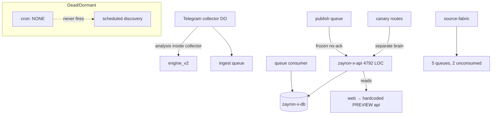
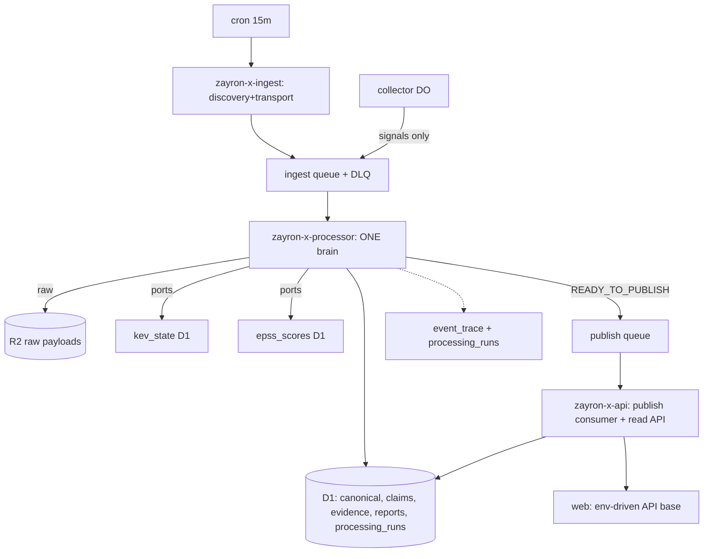

# MASTER TARGET ARCHITECTURE

## Current state (mermaid)

## Target CVE core (mermaid)

## 20+ architectural invariants (each enforceable by schema, gate, or test)
1. ONE CVE ID → ONE logical vulnerability identity (unique canonical id).
2. ONE claim → ≥1 evidence OR explicit UNKNOWN epistemic status.
3. ONE publication state → ONE owner (processor's publish-decision only).
4. ONE processing run → ONE trace lineage (processing_runs PK).
5. ONE source observation → immutable provenance (append-only raw store).
6. AI output → never automatically authoritative (SYNTHESIZED only).
7. OSINT signal → never silently authoritative (class weights monotonic).
8. Repeated queue event → idempotent (unique (source, external_id, content_hash)).
9. Preview → cannot mutate production (explicit per-env bindings).
10. KEV membership → only from catalog evidence (proven post-P0.1).
11. EPSS → measured or UNKNOWN; never synthesized (post-P0.1).
12. Missing critical evidence → confidence capped (no HIGH without primary).
13. Contradiction with AUTHORITATIVE → cap MODERATE + surface dispute.
14. Evidence removal → confidence non-increasing (mutation-tested).
15. Structured source → structured parse; text only for SIGNAL class (no flatten).
16. Domain pipelines share infra; domain logic isolated (new source = adapter+fixtures only).
17. No static intelligence in runtime modules (grep-gate in CI).
18. Every stage emits lifecycle trace with run_id, entity, attempt, duration, versions.
19. Destructive ops require backup-export + dependency proof + separate phase.
20. One migration journal; no direct-to-prod SQL.
21. R2 = raw/immutable only; Vectorize = derivable index only; DO = coordination only.
22. Failure isolation: one poisoned object quarantines itself, never the batch.

## Domain boundaries
Shared: identity, evidence, claims, provenance, relationships, validation, confidence, publication, trace, infra. Isolated per domain: canonical model, mapper set, analysis rules. CVE first; malware/campaign/actor plug in as (model + mappers + fixtures) without infra changes.

## Relationship model
Every edge (CVE↔product, CVE↔exploit, CVE↔malware, actor↔campaign, campaign↔CVE, infra↔actor) carries: source_id, evidence_ids, scope (subject binding), truth_type (OBSERVED/VERIFIED/SUPPORTED/INFERRED/CANDIDATE/CAMPAIGN_CONTEXT/UNKNOWN/CONTRADICTED/STALE), confidence, observed_at. `inherits_facts:false` principle (micro76) generalized.

## Temporal + schema versioning
Separate columns: source_published_at, source_modified_at, observed_at, ingested_at, analyzed_at, published_at. A reprocessing run writes a new report version; it never overwrites source-time semantics. Versioned: source payload schema, domain canonical schema, analysis version, report schema, API version, pipeline version, model/prompt version — all recorded in processing_runs + report metadata.
