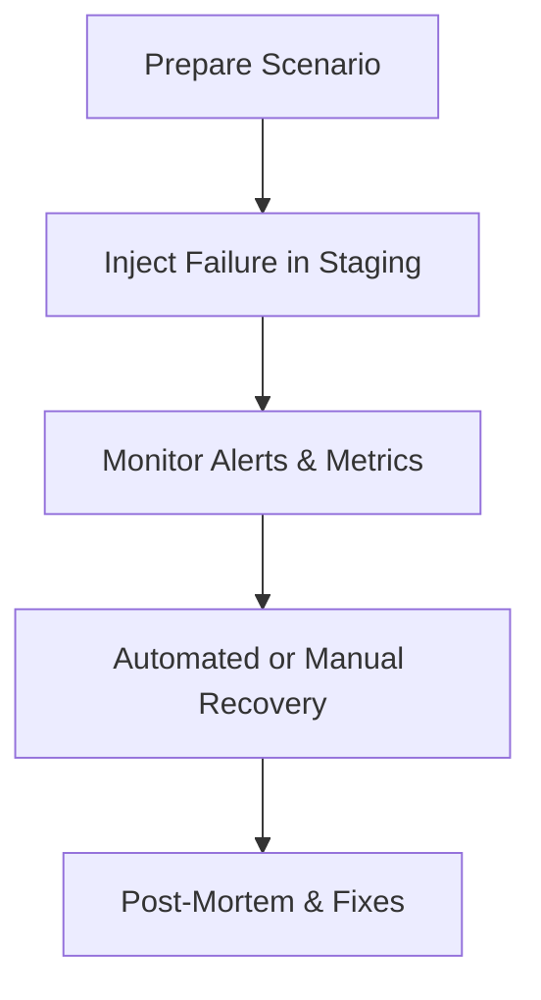

# ZAYRON-X Self-Healing & Resilience Roadmap

This document outlines the state of cellular anti-fragility in the ZAYRON-X platform and sets the trajectory for future resilience and Chaos Engineering experiments.

---

## 🧬 1. Current Anti-Fragility Mechanisms

We have injected several **Chaos Monkeys** into the core DNA of ZAYRON-X:

- **Cache Stampede Mutex Lock**: Prevents thundering herds from overwhelming database nodes. Implements SET NX request coalescing with automated polling.
- **RSC Session Crash Try-Catch**: Wraps Server Component cookie write attempts in a try-catch block to prevent HTTP 500 crashes, enqueuing them to a global in-memory `sessionRefreshQueue` consumed by the middleware.
- **Rate-Limiting IP Spoofing Mitigation**: Prioritizes Cloudflare-provided headers (`CF-Connecting-IP`) to block spoofing vectors.
- **Chaos Latency Injection (`CHAOS_REDIS_LATENCY_MS`)**: Artificially slows down Redis operations to test the behavior of the circuit breaker.
- **Force Session Expiry (`CHAOS_FORCE_SESSION_EXPIRY`)**: Simulates token expiration to verify cookie retry queue resilience under continuous load.
- **Strip Cloudflare Headers (`CHAOS_STRIP_CF_HEADERS`)**: Simulates the absence of Cloudflare CDN layers to verify safe fallback path resolution.

---

## 🧪 2. Future Chaos Engineering Experiments

We plan to inject the following simulated failures to test system response:

### ⚡ Experiment A: KV Namespace Destruction
- **Method**: Randomly delete, corrupt, or revoke permissions on Cloudflare KV namespaces.
- **Goal**: Verify that open-next's `incrementalCache` falls back gracefully to origin generation without causing application outages.

### ⚡ Experiment B: Redis Cache Corruption
- **Method**: Insert invalid binary data or malformed JSON payloads into the Redis cache keys.
- **Goal**: Verify that the type-safe parser discards corrupted entries and refreshes cache hits without breaking user sessions or pages.

### ⚡ Experiment C: Supabase Regional Outage
- **Method**: Block requests from Edge Workers to the primary Supabase Postgres endpoint using HTTP interceptors.
- **Goal**: Verify that read-only pages serve stale cached items from Redis, keeping the threat dashboard readable during database downtimes.

---

## 🎮 3. Quarterly Game Days Plan

To operationalize chaos engineering, the engineering team will execute quarterly Game Days:

- **Q1 Game Day: Cache Death**: Kill the Upstash Redis clusters entirely. System must survive by serving direct database hits under rate limiting.
- **Q2 Game Day: Rogue Session Bombardment**: Simulate millions of expired sessions using `CHAOS_FORCE_SESSION_EXPIRY`. Verify zero-downtime refresh queue behavior.
- **Q3 Game Day: CDN Bypass Security Test**: Bypass Cloudflare using IP-direct paths. Verify rate limit blocks still function on fallback headers.
- **Q4 Game Day: Database Outage Resilience**: Simulate complete DB read/write failure. Verify read-only caching and error-page fallback performance.
