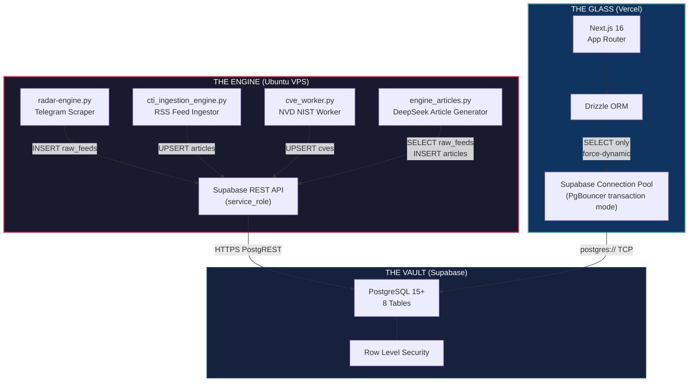
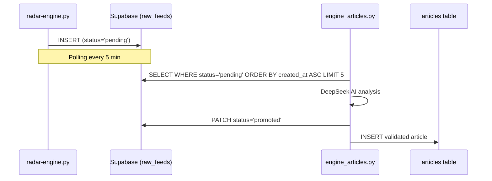
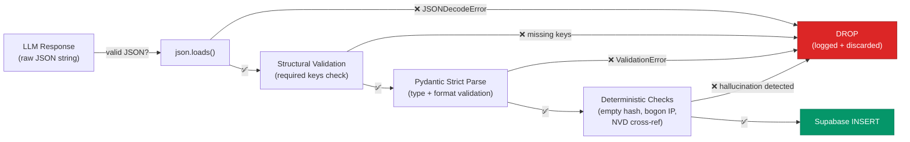

# ZAYRON-X — System Architecture Document (SAD)

> **Classification:** INTERNAL — Engineering  
> **Version:** 3.0  
> **Date:** 2026-05-19  
> **Author:** Principal Systems Architect  
> **Scope:** Full end-to-end system decomposition grounded in the live codebase

---

## Table of Contents

1. [System Architecture Overview](#1-system-architecture-overview)
2. [Inter-Zone Communication Model](#2-inter-zone-communication-model)
3. [The Dockerized Backend Structure](#3-the-dockerized-backend-structure)
4. [The AI Validation Logic](#4-the-ai-validation-logic)
5. [Data Flow: End-to-End Trace](#5-data-flow-end-to-end-trace)
6. [Schema Contract Enforcement](#6-schema-contract-enforcement)
7. [Security Posture](#7-security-posture)
8. [Failure Modes & Resilience](#8-failure-modes--resilience)
9. [Architecture Gaps & Recommendations](#9-architecture-gaps--recommendations)

---

## 1. System Architecture Overview

ZAYRON-X is decomposed into three physically isolated zones with strict unidirectional data flow. The design follows a **producer-consumer** pattern where the backend is the sole writer and the frontend is a pure reader. No user-generated mutations flow backward from Glass to Engine.



### Zone Isolation Principle

| Zone | Network Boundary | Auth Model | Write Access | Read Access |
|------|------------------|------------|-------------|-------------|
| **Engine** (VPS) | Private Docker network + egress to Supabase REST | `service_role` API key (bypasses RLS) | Full CRUD on all tables | Full |
| **Vault** (Supabase) | Supabase-managed infra, exposed via PostgREST + raw TCP | RLS policies per table per role | Only via `service_role` | `anon` role: SELECT on published rows only |
| **Glass** (Vercel) | Vercel Edge network, egress to Supabase `DATABASE_URL` | `DATABASE_URL` with `prepare: false` (PgBouncer compat) | **None.** Read-only by design | Published rows via Drizzle ORM |

> [!IMPORTANT]
> The Glass has **zero write paths** to the Vault. The only exception is the `/api/subscribe` route which inserts into the `subscribers` table and the `/api/views` route which increments `articles.views`. Both are anon-scoped RLS-gated operations. No Engine data can be modified from the frontend.

---

## 2. Inter-Zone Communication Model

The three zones use two fundamentally different communication protocols. Understanding this distinction is critical.

### 2.1 Engine → Vault: HTTP PostgREST (Supabase REST API)

All four Python workers ([cti_ingestion_engine.py](file:///d:/Desktop/zayron-app/cti_ingestion_engine.py), [radar-engine.py](file:///d:/Desktop/zayron-app/radar-engine.py), [cve_worker.py](file:///d:/Desktop/zayron-app/cve_worker.py), [engine_articles.py](file:///d:/Desktop/zayron-app/engine_articles.py)) communicate with Supabase via its REST API:

```
POST  {SUPABASE_URL}/rest/v1/{table}?on_conflict={column}
PATCH {SUPABASE_URL}/rest/v1/{table}?id=eq.{uuid}
GET   {SUPABASE_URL}/rest/v1/{table}?{filters}&select={columns}
```

**Authentication:** Every request carries two headers:
```
apikey: {SUPABASE_SERVICE_KEY}
Authorization: Bearer {SUPABASE_SERVICE_KEY}
```

The `service_role` key bypasses all RLS policies. This is intentional — the Engine is the trusted writer that has already validated data through the AI pipeline.

**Conflict Resolution:** Upserts use the `Prefer: resolution=merge-duplicates` header with `on_conflict` set to the natural key:
- `articles` → `url_hash` (SHA-256 of source URL)
- `cves` → `cve_id` (e.g., `CVE-2026-12345`)

### 2.2 Glass → Vault: Direct PostgreSQL (Drizzle ORM)

The Next.js frontend connects directly to the database via the `postgres://` protocol through Supabase's PgBouncer connection pooler:

```typescript
// lib/db/index.ts
const client = postgres(process.env.DATABASE_URL!, {
  prepare: false,  // Required for PgBouncer transaction-mode pooling
});
export const db = drizzle(client, { schema });
```

**Why `prepare: false`?** Supabase uses PgBouncer in transaction mode. Prepared statements are bound to a specific backend connection, but PgBouncer reassigns connections between transactions. Without `prepare: false`, you get `prepared statement does not exist` errors under load.

**Rendering mode:** Every page uses `force-dynamic`. There is no ISR, no static generation, no client-side caching. Every page request triggers a live SQL query:

```typescript
// Example from lib/db/queries/articles.ts
export async function getArticles(page = 1, pageSize = PAGE_SIZE) {
  return db.select().from(articles)
    .where(publishedCondition())
    .orderBy(desc(articles.createdAt))
    .limit(pageSize).offset(offset);
}
```

### 2.3 Engine → Engine (Internal): No Message Broker Currently

> [!WARNING]
> **Critical architecture gap.** Your mission brief describes Redis as a message broker and Celery as a task queue. The current codebase does **not** use either. All four Python workers are standalone `asyncio` daemons with their own polling loops. They coordinate implicitly through the `raw_feeds` table's `status` column (a database-as-queue anti-pattern). See [Section 9](#9-architecture-gaps--recommendations) for the migration path.

The current inter-worker coordination:



---

## 3. The Dockerized Backend Structure

Your current codebase has all four Python workers as flat files in the project root. Below is the **target** Dockerized structure for the Ubuntu VPS, designed for production isolation.

### 3.1 Recommended Directory Tree

```
/opt/zayron-x/
├── docker-compose.yml            # Orchestrator — single entry point
├── .env                          # Shared secrets (never committed)
├── .env.example                  # Template for operators
│
├── shared/                       # Shared Python packages
│   ├── __init__.py
│   ├── supabase_client.py        # Unified Supabase REST client
│   ├── llm_client.py             # OpenAI-compat client factory
│   ├── models/                   # Pydantic strict schemas (THE TRUTH)
│   │   ├── __init__.py
│   │   ├── article.py            # ArticleSITREP model
│   │   ├── cve.py                # CVERecord model
│   │   ├── ioc.py                # IoC model (SHA256, IPv4, Domain)
│   │   └── raw_feed.py           # RawFeed model
│   ├── validators/               # Deterministic validation logic
│   │   ├── __init__.py
│   │   ├── hash_validator.py     # SHA-256/MD5 empty-hash detection
│   │   ├── ip_validator.py       # RFC 5737 bogon/reserved IP filter
│   │   ├── cve_validator.py      # CVE-ID format + NVD cross-check
│   │   └── domain_validator.py   # TLD validation, IDN homoglyph detection
│   └── dedup.py                  # SHA-256 content dedup (SQLite-backed)
│
├── workers/                      # One directory per isolated worker
│   ├── radar/
│   │   ├── Dockerfile
│   │   ├── requirements.txt
│   │   └── main.py               # radar-engine.py (Telegram scraper)
│   │
│   ├── rss-ingestor/
│   │   ├── Dockerfile
│   │   ├── requirements.txt
│   │   └── main.py               # cti_ingestion_engine.py (RSS feeds)
│   │
│   ├── cve-worker/
│   │   ├── Dockerfile
│   │   ├── requirements.txt
│   │   └── main.py               # cve_worker.py (NVD NIST poller)
│   │
│   └── article-engine/
│       ├── Dockerfile
│       ├── requirements.txt
│       └── main.py               # engine_articles.py (DeepSeek article gen)
│
├── celery/                       # Future: Celery task queue
│   ├── Dockerfile
│   ├── celeryconfig.py
│   └── tasks.py                  # Task definitions wrapping workers
│
├── redis/                        # Future: Redis message broker
│   └── redis.conf
│
├── monitoring/                   # Observability
│   ├── prometheus.yml
│   └── grafana/
│       └── dashboards/
│           └── zayron-pipeline.json
│
└── scripts/
    ├── healthcheck.sh            # Docker HEALTHCHECK script
    └── migrate.py                # Schema migration runner
```

### 3.2 Docker Compose Structure

```yaml
# docker-compose.yml
version: "3.9"

x-common-env: &common-env
  SUPABASE_URL: ${SUPABASE_URL}
  SUPABASE_SERVICE_KEY: ${SUPABASE_SERVICE_KEY}

services:
  # ─── Phase 1: Current Workers (standalone daemons) ───
  radar:
    build: ./workers/radar
    restart: unless-stopped
    environment:
      <<: *common-env
      TELEGRAM_API_ID: ${TELEGRAM_API_ID}
      TELEGRAM_API_HASH: ${TELEGRAM_API_HASH}
      SCAN_INTERVAL: "5"
    volumes:
      - radar-dedup:/app/data  # SQLite dedup cache persistence
    healthcheck:
      test: ["CMD", "python", "-c", "import aiohttp; print('ok')"]
      interval: 60s

  rss-ingestor:
    build: ./workers/rss-ingestor
    restart: unless-stopped
    environment:
      <<: *common-env
      LLM_API_KEY: ${LLM_API_KEY}
      LLM_BASE_URL: ${LLM_BASE_URL}
      LLM_MODEL: ${LLM_MODEL}
      POLL_INTERVAL: "15"

  cve-worker:
    build: ./workers/cve-worker
    restart: unless-stopped
    environment:
      <<: *common-env
      NVD_API_KEY: ${NVD_API_KEY}
    # Cron-scheduled: runs once per cycle, then sleeps

  article-engine:
    build: ./workers/article-engine
    restart: unless-stopped
    environment:
      <<: *common-env
      DEEPSEEK_API_KEY: ${DEEPSEEK_API_KEY}
      DEEPSEEK_MODEL: ${DEEPSEEK_MODEL}
      BATCH_SIZE: "5"
      POLL_INTERVAL: "5"

  # ─── Phase 2: Redis + Celery (future) ───
  # redis:
  #   image: redis:7-alpine
  #   volumes:
  #     - redis-data:/data
  #   command: redis-server --appendonly yes

  # celery-worker:
  #   build: ./celery
  #   command: celery -A tasks worker --loglevel=info --concurrency=4
  #   depends_on: [redis]
  #   environment:
  #     <<: *common-env
  #     CELERY_BROKER_URL: redis://redis:6379/0

volumes:
  radar-dedup:
  # redis-data:
```

### 3.3 Worker Dockerfile Pattern

Each worker follows an identical Dockerfile template:

```dockerfile
FROM python:3.12-slim

WORKDIR /app

# Install shared package first (cache layer)
COPY shared/ /app/shared/
RUN pip install --no-cache-dir -r shared/requirements.txt 2>/dev/null || true

# Worker-specific deps
COPY requirements.txt .
RUN pip install --no-cache-dir -r requirements.txt

COPY main.py .

# Non-root execution
RUN adduser --disabled-password --no-create-home worker
USER worker

CMD ["python", "-u", "main.py"]
```

---

## 4. The AI Validation Logic

This is the most architecturally critical section. The core challenge: **LLMs hallucinate.** At Temperature 0, GPT-4o still fabricates CVE IDs, invents SHA-256 hashes, and generates syntactically valid but semantically meaningless IP addresses. Your system uses a three-layer defense-in-depth strategy to prevent hallucinated data from reaching the database.

### 4.1 Layer 1: Constrained Output Schema (LLM Output Shaping)

Every LLM call enforces `response_format: { type: "json_object" }` and a strict system prompt that defines the exact JSON keys. This forces the LLM to emit parseable JSON rather than freeform text.

From [cti_ingestion_engine.py](file:///d:/Desktop/zayron-app/cti_ingestion_engine.py#L607-L617):
```python
response = await llm.chat.completions.create(
    model=LLM_MODEL,
    messages=[
        {"role": "system", "content": CTI_SYSTEM_PROMPT},
        {"role": "user", "content": raw_text},
    ],
    temperature=0.15,       # Near-deterministic
    max_tokens=8_192,
    response_format={"type": "json_object"},  # Enforces valid JSON
)
```

**What this catches:** Malformed outputs, missing closing braces, commentary outside JSON structure, markdown fences wrapping the response.

**What this does NOT catch:** Valid JSON containing hallucinated values. A perfectly-formed `{"cve_id": "CVE-2026-99999", ...}` is syntactically valid but semantically false.

### 4.2 Layer 2: Structural Validation (Required Field Enforcement)

After JSON parsing, the system validates that all required keys exist and array fields are typed correctly.

From [cti_ingestion_engine.py](file:///d:/Desktop/zayron-app/cti_ingestion_engine.py#L569-L590):
```python
SITREP_REQUIRED_KEYS: frozenset[str] = frozenset({
    "title", "executive_summary", "content", "mitre_attack_ttps",
    "category", "severity", "financialExposure", "regulatoryRisk",
    "mitigationImpact",
})

def validate_sitrep(raw: dict[str, Any]) -> dict[str, Any] | None:
    if not isinstance(raw, dict):
        return None
    missing = SITREP_REQUIRED_KEYS - raw.keys()
    if missing:
        log.warning("SITREP missing keys: %s", missing)
        return None
    # Coerce array fields
    for key in ("mitre_attack_ttps", "affected_sectors", "iocs", ...):
        if not isinstance(raw.get(key), list):
            raw[key] = []
    return raw
```

**What this catches:** Partially-generated responses (LLM timeout mid-generation), schema drift (LLM invents new keys), type confusion (string where list expected).

### 4.3 Layer 3: Deterministic Semantic Validation (The Hard Gate)

> [!IMPORTANT]
> **This is where hallucination actually dies.** Layers 1 and 2 catch structural failures. Layer 3 catches *semantic* lies using deterministic Python logic that cannot be fooled.

The current implementation has this partially built into the CVE worker. Here is the **target** validation architecture using Pydantic:

```python
# shared/models/ioc.py — The Pydantic Truth Gate
from pydantic import BaseModel, field_validator, model_validator
import re
import ipaddress

# SHA-256 of empty string — the #1 LLM hallucination artifact
EMPTY_SHA256 = "e3b0c44298fc1c149afbf4c8996fb92427ae41e4649b934ca495991b7852b855"
EMPTY_MD5 = "d41d8cd98f00b204e9800998ecf8427e"

class IoC(BaseModel, strict=True):
    type: Literal["SHA256", "MD5", "IPv4", "IPv6", "Domain", "URL", "Email"]
    value: str
    context: str
    confidence: Literal["High", "Medium", "Low"]

    @field_validator("value")
    @classmethod
    def validate_ioc_value(cls, v: str, info) -> str:
        ioc_type = info.data.get("type")
        
        if ioc_type == "SHA256":
            if not re.fullmatch(r"[a-fA-F0-9]{64}", v):
                raise ValueError(f"Invalid SHA-256: {v}")
            if v.lower() == EMPTY_SHA256:
                raise ValueError("Rejected: SHA-256 of empty string (hallucination)")
                
        elif ioc_type == "MD5":
            if not re.fullmatch(r"[a-fA-F0-9]{32}", v):
                raise ValueError(f"Invalid MD5: {v}")
            if v.lower() == EMPTY_MD5:
                raise ValueError("Rejected: MD5 of empty string (hallucination)")
                
        elif ioc_type == "IPv4":
            try:
                addr = ipaddress.IPv4Address(v)
            except ipaddress.AddressValueError:
                raise ValueError(f"Invalid IPv4: {v}")
            # Reject RFC 5737 documentation IPs, loopback, link-local
            if addr.is_private or addr.is_loopback or addr.is_reserved:
                raise ValueError(f"Rejected non-routable IP: {v}")
            # Reject common LLM placeholder IPs
            if v in ("1.2.3.4", "8.8.8.8", "192.168.1.1", "10.0.0.1"):
                raise ValueError(f"Rejected placeholder IP: {v}")
                
        elif ioc_type == "Domain":
            if not re.fullmatch(r"[a-zA-Z0-9]([a-zA-Z0-9\-]{0,61}[a-zA-Z0-9])?(\.[a-zA-Z]{2,})+", v):
                raise ValueError(f"Invalid domain: {v}")
            # Reject known LLM hallucination domains
            if v in ("example.com", "malware.com", "evil.com", "attacker.com"):
                raise ValueError(f"Rejected placeholder domain: {v}")
                
        return v
```

```python
# shared/validators/cve_validator.py — NVD Cross-Reference
import urllib.request
import json

def verify_cve_exists(cve_id: str) -> bool:
    """Cross-check a CVE ID against the NVD NIST API.
    Returns True only if NVD returns a valid, non-rejected record."""
    if not re.fullmatch(r"CVE-\d{4}-\d{4,}", cve_id):
        return False
    
    url = f"https://services.nvd.nist.gov/rest/json/cves/2.0?cveId={cve_id}"
    try:
        with urllib.request.urlopen(url, timeout=10) as resp:
            data = json.loads(resp.read())
            return data.get("totalResults", 0) > 0
    except Exception:
        return False  # If we can't verify, we drop it
```

### 4.4 The Validation Pipeline (Conceptual Flow)



**Key principle:** Every gate is **fail-closed.** If validation cannot confirm data is real, the data is dropped. This means some legitimate intelligence may be lost, but zero hallucinated data reaches the database. This is the correct trade-off for a CTI platform.

---

## 5. Data Flow: End-to-End Trace

Let's trace a single Telegram message from a Russian-language CTI channel until it appears as a fully verified threat intelligence article on the Next.js frontend.

### Step 0: Source — Telegram Channel Post

A user in the `@russian_osint` Telegram channel posts:

```
🔴 Новая RCE уязвимость в Apache Struts CVE-2026-31337
CVSS 9.8, эксплуатация в дикой природе. IoCs:
SHA256: a1b2c3d4e5f6...  (64 hex chars)
C2: 185.220.101.42
```

### Step 1: Radar Engine Scrapes the Channel

[radar-engine.py](file:///d:/Desktop/zayron-app/radar-engine.py) runs on a 5-minute polling loop.

1. **Target Discovery:** Fetches active channels from `radar_targets` table in Supabase.
2. **Scraping:** For public channels, issues an HTTP GET to `https://t.me/s/russian_osint` and parses the HTML with regex ([L293-L346](file:///d:/Desktop/zayron-app/radar-engine.py#L293-L346)). For MTProto-enabled channels, uses Telethon to fetch via the Telegram API.
3. **Language Detection:** The `_detect_language()` function ([L624-L640](file:///d:/Desktop/zayron-app/radar-engine.py#L624-L640)) detects Cyrillic script and tags `language: "ru"`.
4. **Deduplication:** The `DedupCache` ([L98-L178](file:///d:/Desktop/zayron-app/radar-engine.py#L98-L178)) computes SHA-256 of normalized content (lowercased, URLs stripped, whitespace collapsed). If this hash exists in the SQLite cache (72h TTL), the message is rejected as a duplicate.
5. **Category Pre-Tagging:** The `categorize_message()` function ([L453-L467](file:///d:/Desktop/zayron-app/radar-engine.py#L453-L467)) does a lightweight keyword scan. Matches "CVE-", "vulnerability", "CVSS" → tags as `cve`.

**Output:** A `raw_feeds` row is INSERTed into Supabase:

```json
{
  "source_channel": "russian_osint",
  "raw_content": "🔴 Новая RCE уязвимость...",
  "original_language": "ru",
  "status": "pending",
  "timestamp": "2026-05-19T20:00:00Z"
}
```

### Step 2: Article Engine Picks Up the Pending Feed

[engine_articles.py](file:///d:/Desktop/zayron-app/engine_articles.py) polls Supabase every 5 minutes for `raw_feeds WHERE status='pending' ORDER BY created_at ASC LIMIT 5`.

1. **LLM Analysis:** The raw Russian text is sent to DeepSeek AI with the `MASTER_PROMPT` — a 300-line system prompt that enforces:
   - English-only output with translation
   - Mandatory 1500+ word report with all 9 sections
   - Strict JSON output schema with 20+ fields
   - Banned AI-sounding phrases ("In today's digital landscape...")
   - `temperature: 0.3` for near-deterministic output

2. **JSON Parsing with Fallback:** The response is parsed via `json.loads()`. If that fails, a regex fallback (`r'\{[\s\S]*\}'`) attempts to extract JSON from a markdown-fenced response ([L477-L489](file:///d:/Desktop/zayron-app/engine_articles.py#L477-L489)).

3. **Null-Title Gate:** If the LLM sets `"title": null`, the feed is flagged as non-intelligence and skipped. This is the LLM's signal that the source material has no CTI value.

4. **Word Count Check:** A minimum of 800 words is enforced (target is 1500+). Short responses are logged with a warning but still accepted ([L496-L503](file:///d:/Desktop/zayron-app/engine_articles.py#L496-L503)).

5. **Array Coercion:** All array fields (`mitre_attack_ttps`, `iocs`, `yara_rules`, etc.) are forced to `[]` if the LLM returned a non-list type.

### Step 3: Article is Written to Supabase

The validated SITREP is mapped to the `articles` table schema in `build_article_row()`:

```python
row = {
    "title": "Critical RCE in Apache Struts Under Active Exploitation [CVE-2026-31337]",
    "slug": "critical-rce-in-apache-struts-under-active-exploitation-cve-2026-31337",
    "author": "Dr. Tariq Youssef",        # Random from analyst pool
    "category": "Vulnerability Research",
    "content": "## KEY TAKEAWAYS\n- ...",   # Full 1500+ word markdown
    "excerpt": "4-6 sentence BLUF summary...",
    "read_time": 8,                         # Calculated: word_count / 200
    "created_at": "2026-05-19 16:47:23",    # Jittered -5min to -4h
    "url_hash": "a7f3b2c1...",              # SHA-256(raw_content)
}
```

The `raw_feeds` row is updated: `status='promoted'`, `analysis` set to the executive summary.

### Step 4: CVE Worker Independently Enriches

[cve_worker.py](file:///d:/Desktop/zayron-app/cve_worker.py) runs on its own schedule, polling the NVD NIST API for CVEs published in the last 24 hours.

1. **NVD Fetch:** Queries `https://services.nvd.nist.gov/rest/json/cves/2.0` with `pubStartDate` and `pubEndDate` ([L55-L120](file:///d:/Desktop/zayron-app/cve_worker.py#L55-L120)).
2. **CVSS Extraction:** Supports v4.0, v3.1, v3.0, and v2.0 metrics with priority ordering ([L138-L151](file:///d:/Desktop/zayron-app/cve_worker.py#L138-L151)).
3. **Product/Vendor Extraction:** Parses CPE data from the NVD response to extract structured product and vendor names ([L199-L240](file:///d:/Desktop/zayron-app/cve_worker.py#L199-L240)).
4. **Batch Upsert:** Inserts/updates rows in the `cves` table with `on_conflict=cve_id`.

This means if `CVE-2026-31337` is real, the `cves` table now has an authoritative NVD-sourced record with the official CVSS score, vector string, and affected product — independently of anything the LLM generated.

### Step 5: Next.js Frontend Renders the Article

A user visits `https://gerasys.online/intelligence/threat-intelligence/critical-rce-in-apache-struts-under-active-exploitation-cve-2026-31337`.

1. **Route Resolution:** The App Router matches `app/intelligence/threat-intelligence/[slug]/page.tsx`.
2. **Database Query:** The `getArticleBySlug()` function ([articles.ts L13-L20](file:///d:/Desktop/zayron-app/gerasys-online/lib/db/queries/articles.ts#L13-L20)) issues:
   ```sql
   SELECT * FROM articles 
   WHERE slug = 'critical-rce-in-apache-struts...' 
     AND is_published = TRUE 
   LIMIT 1
   ```
3. **RLS Enforcement:** Even though Drizzle connects via `DATABASE_URL`, the Supabase connection pool applies the `anon_read_published_articles` RLS policy. Unpublished articles are invisible.
4. **Markdown Rendering:** The `content` field (raw markdown with `##` headings, code blocks, tables) is rendered client-side with a markdown renderer.
5. **View Increment:** An API call to `/api/views` atomically increments the `views` column.
6. **Related Articles:** The `getRelatedArticles()` query fetches 3 articles from the same category.

### End-to-End Timeline

```
T+0:00   Telegram post published in @russian_osint
T+0:05   radar-engine.py scrapes channel, dedup passes, INSERT raw_feeds
T+0:10   engine_articles.py picks up pending feed, sends to DeepSeek
T+0:13   DeepSeek returns 1800-word SITREP JSON (3s LLM latency)
T+0:13   Validation passes, INSERT into articles table
T+0:14   cve_worker.py (async) confirms CVE-2026-31337 via NVD API
T+0:14   Article visible on frontend (force-dynamic, no cache)
```

**Total latency: ~14 minutes from Telegram post to verified frontend article.**

---

## 6. Schema Contract Enforcement

The schema is defined in three places that must remain synchronized:

| Source of Truth | Location | Role |
|----------------|----------|------|
| SQL DDL | [supabase_schema_setup.sql](file:///d:/Desktop/zayron-app/supabase_schema_setup.sql) | The physical database structure |
| Drizzle Schema | [lib/db/schema.ts](file:///d:/Desktop/zayron-app/gerasys-online/lib/db/schema.ts) | TypeScript compile-time types for frontend queries |
| Python Row Builders | `build_article_row()` in each worker | Runtime dict construction for REST API inserts |

### The Phantom Column Problem

> [!CAUTION]
> If the Drizzle schema references a column that doesn't exist in PostgreSQL (a "phantom column"), every `SELECT *` query touching that column will throw a runtime error. Because the frontend uses `force-dynamic`, this manifests as a **500 error on every page load** — not a build-time failure.

The current defensive mechanism:
- React Error Boundaries catch database errors in `app/(site)/error.tsx` ([error.tsx](file:///d:/Desktop/zayron-app/gerasys-online/app/(site)/error.tsx))
- The Drizzle schema has been surgically cleaned — columns like `mitre_tactics` and `patch_status` referenced in your mission brief have been removed

**The real fix:** The `drizzle-kit push` or `drizzle-kit generate` commands compare `schema.ts` against the live database and emit migration SQL. Run this in CI to catch drift before deployment.

---

## 7. Security Posture

### 7.1 Authentication Boundaries

| Credential | Scope | Risk if Leaked |
|-----------|-------|----------------|
| `SUPABASE_SERVICE_KEY` | Full CRUD, bypasses all RLS | **CRITICAL** — attacker can read/write/delete all tables |
| `DATABASE_URL` | Direct Postgres access | **CRITICAL** — same as above, but via SQL |
| `DEEPSEEK_API_KEY` | LLM API access | **HIGH** — cost exposure, but no data access |
| `TELEGRAM_API_ID/HASH` | Telegram scraping | **MEDIUM** — account compromise |
| `NVD_API_KEY` | NVD rate limit upgrade | **LOW** — public data, just higher throughput |

### 7.2 RLS Policy Design

From [supabase_schema_setup.sql](file:///d:/Desktop/zayron-app/supabase_schema_setup.sql#L199-L280):

- `anon` role can SELECT `articles` only where `is_published = TRUE`
- `anon` role can SELECT `cves`, `analysts`, `tools`, `trending` (all rows)
- `anon` role can INSERT into `subscribers` (email collection)
- `anon` role has **zero access** to `raw_feeds` (internal pipeline data)
- `service_role` has unrestricted CRUD on all tables

### 7.3 Security Headers

From [next.config.ts](file:///d:/Desktop/zayron-app/gerasys-online/next.config.ts#L3-L13), the CSP and security headers are solid:
- CSP restricts scripts, images, and connections to `self` + Supabase domains
- HSTS with 2-year max-age
- X-Frame-Options: DENY
- No `powered-by` header

---

## 8. Failure Modes & Resilience

| Failure | Impact | Current Mitigation | Gap |
|---------|--------|-------------------|-----|
| LLM timeout (>120s) | Feed stays pending | `asyncio.wait_for()` with timeout, retry with backoff | Feed may be retried indefinitely — no max retry counter per feed |
| Supabase REST 5xx | Data not written | Exponential backoff retry (3 attempts) | No dead-letter queue; failed batches are silently dropped |
| NVD API rate limit (HTTP 403) | CVE worker stalls | 60s sleep on 403, then retry | No circuit breaker; worker blocks its entire cycle |
| Telegram channel goes private | Zero messages scraped | HTTP fallback logs warning | No alerting — operator must check logs manually |
| Drizzle schema drift | Frontend 500 errors | React Error Boundary catches at runtime | No CI check to detect drift before deploy |
| Empty SHA-256 hash from LLM | Hallucinated IoC in DB | **NOT CURRENTLY IMPLEMENTED** — target architecture in Section 4 | **Critical gap** |

---

## 9. Architecture Gaps & Recommendations

### Gap 1: No Redis/Celery (Mission-Critical)

**Current state:** Four standalone asyncio daemons polling Supabase as a job queue.  
**Problem:** The `raw_feeds` table is doing double duty as both a data store and a message queue. This creates polling overhead, race conditions if two engine instances run simultaneously, and no retry/dead-letter semantics.

**Recommendation:**
```
radar-engine.py → Redis (LPUSH) → Celery worker (article-engine) → Supabase
```
Use Redis Streams (not just pub/sub) for at-least-once delivery with consumer groups.

### Gap 2: No Pydantic Validation on LLM Output

**Current state:** Validation is a manual dict-key check (`SITREP_REQUIRED_KEYS`).  
**Problem:** Type coercion, value ranges, and semantic validation (empty hashes, bogon IPs) are not enforced.

**Recommendation:** Implement the `shared/models/` Pydantic architecture from Section 4. Every LLM response should be parsed through `ArticleSITREP.model_validate(parsed_json)` before any database write.

### Gap 3: No Structured Observability

**Current state:** `print()` and `logging.info()` to stdout.  
**Problem:** No metrics, no tracing, no alerting. You cannot answer "how many articles were generated in the last 24 hours?" without parsing log files.

**Recommendation:** Export Prometheus metrics from each worker (articles_generated_total, llm_latency_seconds, validation_failures_total). Deploy Grafana for dashboards.

### Gap 4: Schema Sync is Manual

**Current state:** Three separate definitions (SQL, Drizzle, Python dicts) are kept in sync by developer discipline.  
**Problem:** Any column rename, addition, or removal must be reflected in all three. The Python workers don't even have a schema — they construct raw dicts.

**Recommendation:** Make the Drizzle schema the single source of truth. Use `drizzle-kit generate` to produce SQL migrations. Use `drizzle-kit introspect` to reverse-engineer Pydantic models from the same schema. The Python workers should import models generated from the Drizzle schema, not hand-code dicts.

### Gap 5: `created_at` Jittering is a Data Integrity Risk

**Current state:** `jitter_created_at()` offsets the timestamp by -5min to -4h to make articles appear staggered.  
**Problem:** This breaks `ORDER BY created_at DESC` ordering assumptions. An article published at T=0 may appear as if it was published 4 hours ago, pushing it below legitimately older articles.

**Recommendation:** Add a separate `published_at` column for display ordering. Keep `created_at` as the immutable ingestion timestamp.

---

> **End of Document**  
> *This SAD is a living document. Update it when architectural decisions change.*
