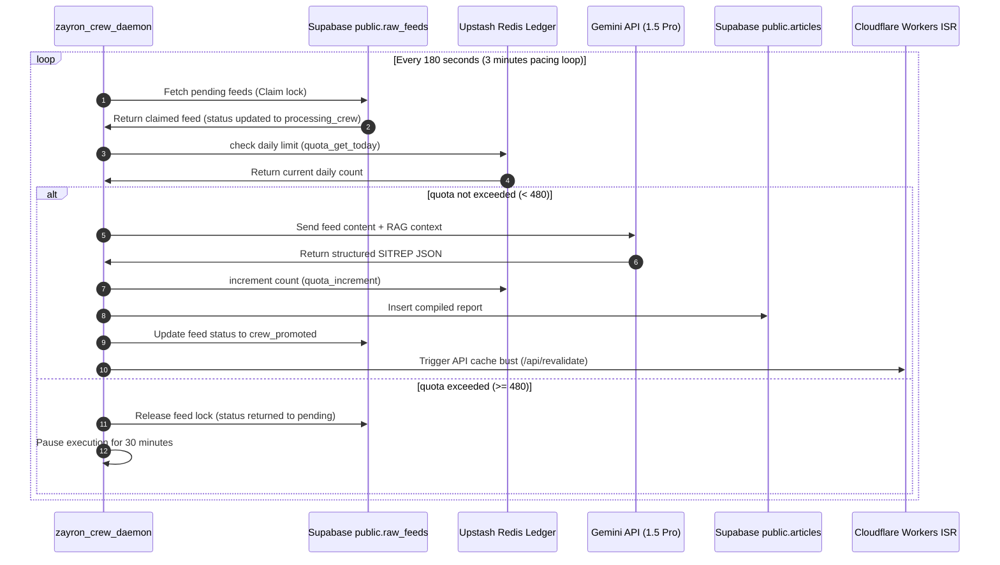

# ZAYRON-X: Event Flow Map Report
**Target System:** ZAYRON-X Autonomous CTI Platform  
**Scope:** Ingestion Streams, Processing Queues, and Event Lifecycle Mapping  
**Timestamp:** 2026-06-11T03:52:00Z  

---

## 1. Ingestion Event Cycles

Ingestion events run as scheduled background daemons:

```
[ Telegram Scraper ] ── (Polls every 5m) ──► Check duplicate in SQLite (radar_dedup.db)
                                                       │
                                                       ▼ (If novel)
                                             Write raw_feeds (pending)

[ RSS Ingestor ]     ── (Polls every 15m) ─► Check duplicate url_hash in database
                                                       │
                                                       ▼ (If novel)
                                             Write raw_feeds (pending)

[ Darkweb Ingestor ] ── (Polls every 5m) ──► Check duplicate url_hash in database
                                                       │
                                                       ▼ (If novel)
                                             Write raw_feeds (pending)

[ CVE Worker ]       ── (Polls every 15m) ─► Calculate Financial Blast Radius
                                                       │
                                                       ▼ (If novel)
                                             Write public.cves (Active)
```

---

## 2. Processing Queue Flow

The core execution queue processes feeds sequentially:



---

## 3. Cache Invalidation Lifecycle

When `persist_sitrep()` successfully completes, Next.js page caches are updated:

```
[ zayron_crew_daemon ]
          │
          ▼ (HTTP POST)
[ /api/revalidate API Endpoint ] 
          │
          ▼ (Verifies REVALIDATION_SECRET signature)
[ Next.js Cache Invalidator ]
          │
          ├─► Invalidate path "/"
          ├─► Invalidate path "/intelligence"
          │
          ▼ (Purges cache keys from Cloudflare KV Namespace)
[ Static site regenerated on next visitor request ]
```
